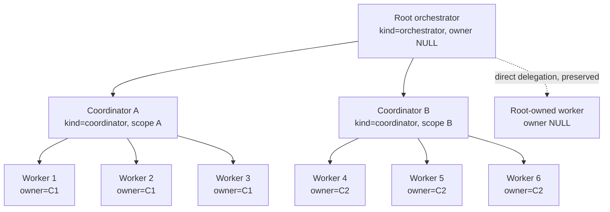
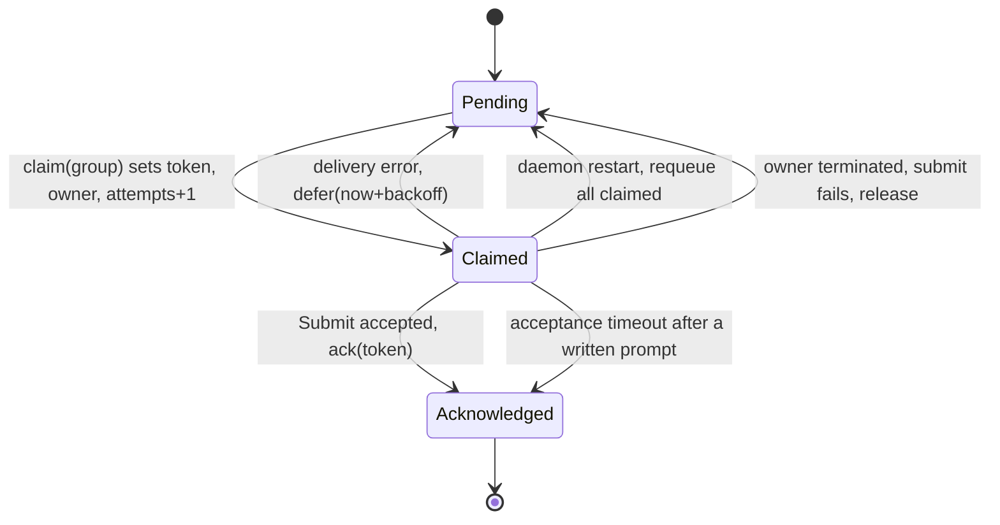
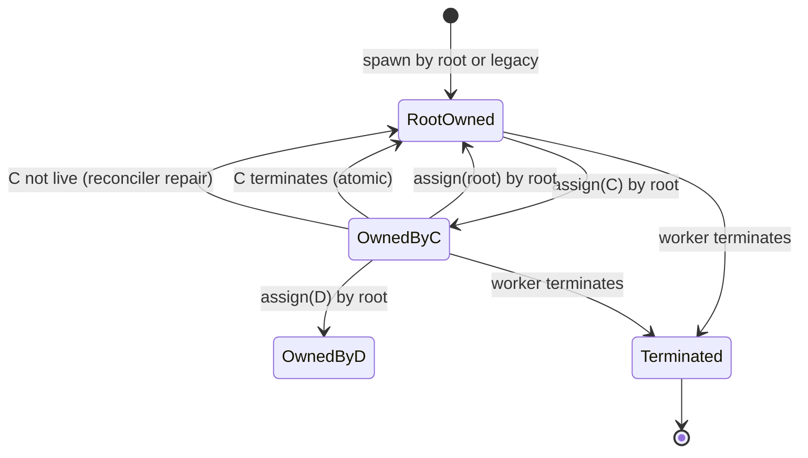
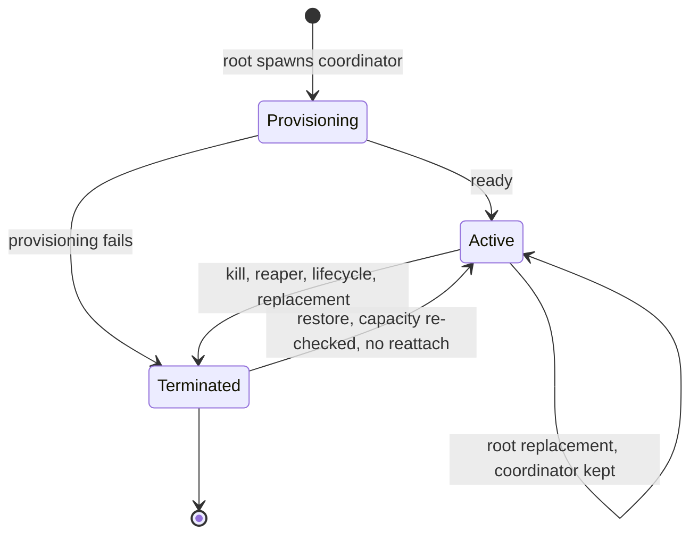

# 10. Coordinator hierarchy and report ownership

Date: 2026-10-19
Status: Accepted (design gate for CO-2; effective when pull request #282 merges)

## Context

AO must let one project orchestrator delegate bounded work to two helper
coordinators, each owning at most three workers, without creating a second
project orchestrator. Worker reports must reach the helper that owns the
worker, helper summaries and escalations must reach the project orchestrator,
and a helper failure must hand its work back safely.

The design input is `docs/backlog/coordinators/coordinator-report.md`. That
document states the intended topology and non-goals. It is not a contract: it
does not define persistence, transition tables, idempotency, remote-link
compatibility, or failure recovery. This ADR is the contract for those
concerns. Where the design input and this ADR disagree, this ADR wins.

### What the code does today

All references are to `origin/dev` at `290a8d3e7` (0.17.1).

- `SessionKind` has exactly two values, and `sessions.kind` is a CHECK pair:
  `('worker', 'orchestrator')` (`backend/internal/domain/session.go`,
  `backend/internal/storage/sqlite/migrations/0001_init.sql`). The API enum and
  the generated OpenAPI schema repeat the pair.
- `Service.Spawn` with `kind=orchestrator` treats the role as a singleton. It
  takes a per-project lock, returns the newest live orchestrator when one
  exists, and only then spawns. `Service.SpawnOrchestrator` is idempotent when
  `clean=false`; with `clean=true` it retires every live orchestrator and
  spawns a replacement. `Service.activeOrchestrators` lists
  `kind='orchestrator'` only.
- `report.Coordinator.activeOrchestrator` selects the newest live
  `KindOrchestrator` in a project. `deliverProject` claims every pending report
  for the project and submits one turn to that session. `DeliverExternal` does
  the same for reports pulled from a peer daemon, using only a project ID.
- Report batching is keyed by project: `AssignPendingReportsToBatch`,
  `ClaimPendingReportsByBatch`, `AcknowledgeReportBatch`, `ReleaseReportBatch`,
  and `DeferReportBatch` all filter on `project_id` plus a claim token
  (`backend/internal/storage/sqlite/queries/reports.sql`). Delivery is
  acceptance-before-ack: `Submit` returns only after the target agent accepted
  the exact message, and the batch is acknowledged only after that. One case is
  consumed instead: `SendSemantic` returns an acceptance timeout only after the
  prompt was written, so that batch is acknowledged and never re-sent. A
  terminated worker's queue is due at once, and its session accepts no new
  reports (`409 SESSION_TERMINATED`).
- `remote_worker_links` stores `host_id`, `remote_session_id`,
  `remote_project_id`, `project_id`, `host_label`, `display_name`, and
  `created_at` (`0199_remote_worker_links.sql`). It does not store the spawning
  parent. `remoteworker.Service.Register` validates `ParentSessionID`, uses its
  project, and then discards it. The pull, record, and acknowledge flow for
  those links is `docs/adr/0005-daemon-pulls-remote-worker-reports.md` (the
  remote-report ADR).
- Local sessions do not persist a parent either. `ParentSessionID` is used at
  spawn time only, by `inheritedSpawnPermissions`, which reads the parent
  session, requires `KindOrchestrator` and the same project, and otherwise
  falls back to the project default.
- `RecordSessionInteraction` credits the target worker's
  `latest_interaction_at` only when the sender is a live `KindOrchestrator` in
  the same project.
- The machine-role rule uses the kind directly:
  `refuseOrchestratorForRemoteWorkers` refuses a new orchestrator when
  remote-spawned workers are live, and
  `refuseRemoteWorkerForLocalOrchestrators` refuses a remote worker when any
  live orchestrator exists on the machine.
- Every termination path funnels through `lifecycle.Manager.MarkTerminated`,
  which sets `is_terminated` and `activity_state='exited'` through the single
  session update path.
- The session store is a single SQLite database owned by one daemon. There is
  no replication, and the primary listener is loopback-only.

### What the backlog asks for

`docs/backlog/coordinators/backlog/README.md` fixes these invariants:

- one root orchestrator per project remains the system of record;
- two coordinators, three active workers per coordinator, six workers total;
- every worker has one durable coordinator owner, and ownership changes are
  explicit and auditable;
- reports go to the worker's owner, summaries and escalations go to the root,
  and delivery stays retry-safe and idempotent;
- only the root merges;
- direct root-to-worker work stays supported;
- all state goes through the daemon's existing persistence boundaries.

CO-2 adds: legacy links without ownership must keep reaching the root, and a
coordinator must be able to send a concise summary or escalation. CO-3 adds:
the root spawns coordinators, over-capacity requests return a clear error, and
helpers cannot exceed another helper's capacity. CO-4 adds: recovery,
rollback, and an operator view.

### Corrections to the backlog text

These corrections are part of the record because implementation work must not
build on them:

1. **`remote_worker_links` does not store the spawning parent.** It never did.
   `remoteworker.Service.Register` validates `ParentSessionID` and keeps only
   its project. There is therefore no historical parent to backfill, and every
   existing remote link must stay root-owned.
2. **Local workers have no parent column.** `sessions` has no parent column,
   and `ParentSessionID` is not persisted. Existing local workers must also
   stay root-owned.
3. **Batching is not per recipient.** `AssignPendingReportsToBatch` and
   `ClaimPendingReportsByBatch` filter only on `project_id`. Owner routing is
   a batching and claiming decision, not just a recipient lookup.
4. **`SpawnOrchestrator` is not simply idempotent.** With `clean=true` it
   retires every live orchestrator first. A root replacement must not retire
   helpers.

## Options

Three representations of a helper coordinator were considered.

| | **A: new `SessionKind`** | **B: orchestrator subtype** | **C: role column / worker flag** |
| --- | --- | --- | --- |
| Schema | Widen the `kind` CHECK; one surgical `sqlite_master` rewrite | Keep `kind='orchestrator'`, add `role` or `scope` | Keep the kind, add a role/scope column |
| Meaning of `KindOrchestrator` after the change | Root, exactly as today | Root **and** helper | Root **and** helper |
| Default when a call site is missed | Coordinator behaves like a worker (fail-closed for root-only rules) | Coordinator behaves like a root (fail-open) | Depends on the column; easy to miss |
| Singleton spawn and replacement | Unchanged: both filter `kind='orchestrator'` | Every singleton path must learn about helpers | Same |
| Report recipient selection | Unchanged root selector; a new coordinator selector | Must exclude helpers in every root selector | Must exclude helpers |
| Project Chat conversation | Coordinator gets a session-scoped conversation automatically | Coordinator would take the project conversation unless every conversation path is audited | Same |
| API and frontend enum | One additive value | No enum change, but a second discriminator on every surface | Same |
| Migration cost | Widen a CHECK, using the existing harness-migration pattern | Add a column plus rewrite every kind check | Add a column plus rewrite every kind check |

Option A is the only one whose failure mode is safe. The backend has 44
`KindOrchestrator` occurrences in non-test code at `290a8d3e7`, counted with
tests excluded. Some of them are root-only and
must stay root-only (singleton spawn, replacement, report recipient, project
conversation, PR claim, the orchestrator fetch route). Others must treat a
coordinator as an orchestrator-role session (role config, prompt, Chat default,
permission inheritance, machine-role refusal). With option A, a missed site
makes the coordinator worker-like, so the root-only rules keep holding. With
options B and C, a missed site makes the coordinator root-like: it can become
the report recipient, retire itself during a root replacement, take the project
conversation, or block the machine-role rule. Those are exactly the failures
this ADR exists to prevent.

Option A also matches behavior the helper needs for free: a per-session Chat
conversation (`chat.Service` chooses the project scope only for
`KindOrchestrator`), a unique worker-style branch (`defaultSessionBranch`),
session-scoped hibernation (the hibernation filter excludes only
`KindOrchestrator`), and the existing worker rejection in
`report.Service.Create`. The migration cost is small: the repository already
widens `sessions` CHECK constraints in place with `PRAGMA writable_schema`
(`0192_allow_openhands_harness.sql`, `0206_allow_opencode_v2_usage.sql`).

Rejected outright, independent of the three options:

- **Replicated hub services or a shared SQLite volume.** SQLite is
  single-writer, and one daemon owns the database, `running.json`, terminal
  hosts, worktrees, and runtime handles. Two daemons on one volume corrupt
  durable state. This ADR keeps one daemon and one database, and helpers are
  sessions inside that daemon.
- **More than one root orchestrator per project.** Reports, merge authority,
  and replacement would all become ambiguous. The one-root invariant is
  restated in section 9.
- **A coordinator as a separate service or process.** Same failure as
  replication, plus a second listener or auth path, which section 10 forbids.
- **A coordinator as a worker with a role flag.** Worker reports are addressed
  by ownership, but a coordinator must also receive orchestrator-role config,
  a coordination prompt, and Chat by default. A flag that every existing kind
  check must consult is option B with extra steps.

## Decision

A helper coordinator is a new `SessionKind` value, `coordinator`. It is a
project-scoped session, spawned only by the live root on the root's daemon. It
uses orchestrator-role configuration and a coordinator prompt, but it is not a
root and has no integration authority.

Topology:



### 1. Role representation

- `SessionKind` gains `coordinator` (`domain.KindCoordinator`).
- The `sessions.kind` CHECK widens to
  `('worker', 'orchestrator', 'coordinator')` with the same surgical
  `sqlite_master` rewrite the harness migrations use. The startup repair that
  reconciles the harness CHECK (`reconcileHarnessConstraint`) must also learn
  the coordinator value, so a database whose goose version skipped the kind
  migration is repaired at startup instead of failing every coordinator write.
- `coordinator_scope` and `owner_session_id` are added with
  `ALTER TABLE ADD COLUMN`; their rules are enforced by triggers, not by an
  ALTERed CHECK constraint. This keeps the migration to the two patterns the
  repository already uses: `writable_schema` for CHECK text and `ALTER` for
  columns.
- The API enum and the generated OpenAPI schema add `coordinator` to
  `kind`. `SessionView.kind` and the CLI output carry it.
- `coordinator` rows carry a required, immutable `coordinator_scope`
  (trimmed, 1..200 characters, control characters stripped). The scope is the
  helper's bounded area of work. Changing the scope means spawning a different
  coordinator, not editing this one.

Coordinator behavior at existing kind-keyed sites:

| Site | Coordinator behavior | Action |
| --- | --- | --- |
| `Service.Spawn` singleton branch | Not a root | Add a separate coordinator branch; the orchestrator branch is unchanged |
| `Service.Spawn` `clientRequestId` guard (`Kind != KindWorker`, `CLIENT_REQUEST_WORKER_REQUIRED`) | Coordinators may be idempotent too | Widen the guard to worker or coordinator; keep rejecting a root; replay uses `replayClientRequest` and returns `CLIENT_REQUEST_CONFLICT` on a mismatched hash, which must cover kind, scope, and parent |
| `Service.Spawn` project guard (`ProjectID == "" && Kind != KindWorker`) | Coordinators require a project | Unchanged; the existing guard rejects a projectless coordinator |
| `Service.Spawn` remote guard (`RemoteSpawn && Kind != KindWorker`) | Coordinators are local only | Unchanged; the existing guard rejects a remote coordinator with `REMOTE_SPAWN_WORKER_REQUIRED` |
| `Service.SpawnOrchestrator`, `activeOrchestrators`, replacement verification | Not a root | Unchanged |
| `report.Coordinator.activeOrchestrator` | Not a root | Unchanged (root selector) |
| `PreparePiggyback` | May receive a piggybacked batch as a recipient | Accept `coordinator` and claim that recipient's group |
| `chat.Service` conversation scope | Session-scoped conversation | Unchanged (only `orchestrator` gets the project scope) |
| `chat_handoff` first Chat use | Session-scoped; no project-conversation fallback | Unchanged |
| `conversation_store` competing live orchestrator check | Root only | Unchanged |
| Promptless orchestrator relaunch | A coordinator has a scope prompt, so it is not promptless | Unchanged |
| `defaultSessionBranch` | Unique session branch | Unchanged |
| `EligibleForChatHibernation` | Eligible when otherwise idle and settled | Unchanged; delivery wakes it |
| `report.Service.Create` | Cannot create worker reports | Unchanged; the existing worker-only guard fails closed |
| `claim_pr` | Workers only; a coordinator cannot claim a PR | Reject every non-worker kind, not only `KindOrchestrator` (the current guard checks the root kind only) |
| Orchestrator fetch route, orchestrator listing | Root only | Unchanged; helpers appear in session and coordinator reads |
| Rename restriction | A coordinator is renameable | Unchanged (the restriction checks the root kind only) |
| `Restore` machine-role check | A coordinator restore applies the same refusal | Widen |
| `withRoleOverride`, `roleOverride`, `roleConfigName`, `effectiveHarness` | Orchestrator role config | Widen to include `coordinator` |
| `resolveAgentLaunchConfig` and permission-mode mapping | Orchestrator role config | Widen |
| Default mode (`manager.resolveSessionMode` path) | Chat by default, like a root | Widen |
| Async Chat spawn guard | Allowed | Widen |
| `inheritedSpawnPermissions` | A coordinator parent may lend its policy; a root parent may lend to a coordinator | Widen |
| `RecordSessionInteraction` | A coordinator sender counts as direction | Widen |
| Machine-role refusals | Any live orchestrator-role session counts | Widen (section 9) |
| `promptRoleForKind`, system prompt, workspace prompt | New coordinator role and template | Add a case; do not reuse the root template |
| `activeOrchestratorSessionID` in a worker's system prompt | Resolve to the worker's owner, not necessarily the root | Make owner-aware |
| Kiro, gitworktree branch-collision, and scratch kind branches | Worker-like | Unchanged; covered by coordinator spawn tests |
| Worker-only surfaces (agent switching, task reports, session-health reports, preview polling, auto-review) | Not a worker | Unchanged; each keeps rejecting a coordinator |
| Automation input kinds | Workers and roots only | Unchanged |
| Copilot orchestrator message | Root-only | Unchanged |

The table groups call sites by behavior, not one row per line. CO-2.1.1 and
CO-2.2.1 must walk every `KindOrchestrator` occurrence and every
`kind != worker` guard, because a search for `KindOrchestrator` alone misses
the worker-only guards; classify each into one of these rows. A `coordinator`
case that is neither root-like nor worker-like needs a test.

The coordinator system prompt is a distinct template. It states the scope, the
three-worker cap, the escalation rules from CO-3.2.1, the prohibition on
merging and on closing project-wide work, and that the root is the only
integration authority. It reuses `orchestratorRules` as standing project
instructions; it does not reuse the root's operating prompt. It does not
hard-code the root session ID: escalation is addressed by role, so a root
replacement does not leave the helper pointing at a terminated session.

### 2. Durable ownership

Ownership is a durable fact on two subject types: local sessions and remote
worker links. Nothing is derived, and nothing is reconstructed from the
runtime.

#### Local sessions

- New nullable column `sessions.owner_session_id TEXT REFERENCES sessions(id)`.
- `NULL` means **root-owned**: the recipient is the project's live root at
  delivery time. It is not a missing-owner error.
- A non-NULL value must reference a live `kind='coordinator'` session in the
  same project. `BEFORE INSERT` and
  `BEFORE UPDATE OF owner_session_id, kind, coordinator_scope` triggers
  enforce: a coordinator row has a non-empty scope that does not change after
  insert, every other kind has an empty one, only a worker may have a non-NULL
  owner, the owner exists, the owner is `kind='coordinator'`, the owner is not
  terminated, and the projects match. The service validates first and returns
  a stable API error; the trigger is the durable backstop.
- A coordinator never has an owner row. Its root is positional: the project's
  single live root. That avoids dangling owner IDs when a root is replaced.
- Only workers own an owner. A coordinator, an orchestrator, or a standalone
  session with a non-NULL owner is rejected.
- The owner foreign key is not `ON DELETE SET NULL` or `CASCADE`. A coordinator
  row cannot be hard-deleted while it owns workers; termination is the path
  that releases them.
- Index `idx_sessions_owner ON sessions(owner_session_id, is_terminated)` for
  capacity counts and recipient lookups.

#### Remote worker links

- New nullable column
  `remote_worker_links.owner_session_id TEXT REFERENCES sessions(id)`.
- `NULL` means the link's `project_id` root.
- A non-NULL value is a **local** coordinator session in `project_id`. Remote
  session IDs are per-daemon, so the remote parent is never stored and never
  referenced. `Register` keeps validating `ParentSessionID`, then derives the
  owner: a live `coordinator` parent in the same project becomes the owner;
  a root parent, a worker parent, or no owner-eligible parent stores `NULL`.
- The owner is chosen when the link is created. It is never sent to the remote
  host. Re-registering an existing `(host_id, remote_session_id)` link keeps
  `project_id` and `owner_session_id` fixed; it updates only
  `remote_project_id`, `host_label`, and `display_name`. A re-registration
  naming a different local project is rejected with
  `REMOTE_WORKER_LINK_PROJECT_CONFLICT` rather than moving the link. This keeps
  I4 true: the stored owner is always a coordinator in the link's project. A
  coordinator cannot adopt a remote worker by re-registering it. Changing a
  remote owner uses the ownership write path like a local worker, and is
  audited in `remote_worker_owner_events`.
- A remote link counts as one active worker until the remote-report ADR's
  retire rule deletes it. Local runtime state for a remote worker is not
  readable here, so link presence is the durable capacity fact.
- Indexes on `remote_worker_links(owner_session_id)` and
  `remote_worker_links(project_id)` support capacity counts and the roster.

#### Audit

Two append-only tables record every ownership change:

- `session_owner_events(session_id, previous_owner_session_id,
  new_owner_session_id, reason, created_at)`; `session_id` references
  `sessions(id)` with cascade on delete.
- `remote_worker_owner_events(host_id, remote_session_id,
  previous_owner_session_id, new_owner_session_id, reason, created_at)`; the
  link identity references the link with cascade on delete.

`reason` is a bounded value: `spawn_parent`, `explicit_assignment`,
`explicit_reassignment`, `coordinator_terminated`, and
`owner_not_live_reconciled`. The previous and new owner values are plain text,
not foreign keys, so an audit row still names an owner that was later removed.
The audit row itself is tied to its subject. It is written in the same
transaction as the change, and termination writes audit rows before it clears
the owner columns.

#### Ownership is not a report fact

A report does not store its owner at creation. Ownership is resolved at
delivery time and frozen only on the claim (`delivery_owner_id`, section 4). A
report therefore cannot go stale because ownership changed after it was
created; it follows the current ownership until it is claimed.

### 3. Recipient resolution

One rule serves local delivery, remote delivery, and piggyback:

```text
recipient(project, worker):
  owner := worker.owner_session_id          # local row, or link row
  if owner is not NULL:
    if owner is a live coordinator in project:
      if owner.activity_state != 'exited':
        return owner
      # exited, not terminated: route to root, keep ownership (#387)
      notify root once per exit; return live root of project
    # durable repair, not a silent reroute
    set owner := NULL; audit(owner_not_live_reconciled)
  return live root of project                # newest live kind='orchestrator'
```

"Live" means `is_terminated = 0`. The root selector also skips
`activity_state='exited'`, as `activeOrchestrator` does today. A coordinator
whose row is live but whose agent exited (amended for #387) is not a live
recipient: its workers' reports go to the live root **without clearing the
ownership**, because a crashed coordinator may be restored and then resumes
receiving them. The root is told once per exit that the coordinator needs
recovery. The exit time keys the notice and its delivery id, so a later exit
is a new notice and a replacement root is told again. Capacity counting
is unchanged: the exited, not-terminated coordinator keeps its slot. Delivery to
an exited coordinator therefore never retries in a loop; `DeliverExternal`
rejects it like an exited root.

Resolution table:

| Worker or link | Owner | Recipient |
| --- | --- | --- |
| Local worker | `NULL` | Project root |
| Local worker | Live coordinator C | C |
| Local worker | Terminated coordinator C | Root, after repair to `NULL` |
| Local worker | Exited, not terminated coordinator C | Root, owner kept, one recovery notice |
| Remote link | `NULL` | Project root |
| Remote link | Live coordinator C | C |
| Remote link | Invalid or terminated owner | Root, after repair to `NULL` |
| Remote link | Exited, not terminated coordinator C | Root, owner kept, one recovery notice |
| Coordinator summary | Not applicable | Project root, always |
| Root-owned direct worker | `NULL` | Project root (unchanged behavior) |
| Standalone worker | Not applicable | No project, no report (existing rejection) |

The remote path uses the same function with the link's `project_id` and
`owner_session_id`. A remote link never carries a remote coordinator ID, so a
peer daemon cannot influence local recipient selection.

Routing is exclusive: a coordinator-owned worker's report is delivered to that
coordinator and not also to the root. The root's visibility comes from the
coordinator's summaries, escalations, and the operator read model, not from a
copy of every worker report.

If no live root exists for a root-addressed report, the report stays `pending`
and is never acknowledged. Coordinator-addressed reports still deliver while
the root is unavailable. A root outage must not stop helper delivery.

### 4. Per-owner batching, claiming, and delivery

A **delivery group** is
`(project_id, recipient_session_id, queue, coordinator_session_id)`. `queue`
is `worker_reports` or `coordinator_summaries`. For `worker_reports`,
`coordinator_session_id` is empty, except for the exited-owner group (#387):
the root's group for the workers of one exited, not terminated coordinator
carries that coordinator as an exited-owner dimension. All other workers of a
recipient share one group. For `coordinator_summaries`, `coordinator_session_id` is the
coordinator, so each helper has its own group and its own cadence, and the
recipient is always the root. All work in a group has the same recipient,
queue, and coordinator dimension. A remote worker group is assembled across
links that share the owner; acknowledgement remains per link.

Changes to the report row:

- `reports.delivery_owner_id TEXT NOT NULL DEFAULT ''`, written at claim. It
  records which recipient a claimed batch was accepted for. It is diagnostic
  and audit data, not a routing input.
- The batch id remains the durable delivery identity: the pre-assigned
  `delivery_batch_id` when present, otherwise a hash of the sorted report IDs
  (`PreparedBatch.IdempotencyKey`). Batching is per group, so two recipients never
  share a batch id, and two helpers never share a summary batch id.

Claims are group-scoped, and the predicate depends on the queue:

- `worker_reports`: join `sessions` through `reports.session_id`. A normal
  group compares `COALESCE(sessions.owner_session_id, <root id>)` with the
  resolved recipient. An exited-owner group instead matches only
  `sessions.owner_session_id = <exited coordinator>` (`fallback_owner_id`),
  never the root-owned workers, so one batch id cannot span the root group and
  an exited-owner group. Its delivery id is `<batch id>:exited:<coordinator>`,
  because both groups address the same root. The claim
  selects pending reports in the group, including reports not yet at
  `available_at`, preserving today's rule that a due, attention, or piggyback
  trigger includes earlier batch work for the same recipient.
- `coordinator_summaries`: select rows where `project_id = :project`,
  `coordinator_session_id = :coordinator`, and
  `delivery_state = 'pending'`, then claim them with the batch token and
  submit one root-addressed turn. The recipient is the root by definition, and
  the coordinator is the group's coordinator dimension.

A claim never spans recipients or coordinator dimensions.



Transition table:

| From | Event | Guard | Durable action | To |
| --- | --- | --- | --- | --- |
| `pending` | Scheduler selects the group | Recipient resolves; earliest report is due | None | `pending` |
| `pending` | Claim | No other live claim in the group | Set `delivery_batch_id`, `delivery_owner_id`, `claim_token`, `claimed_at`; `delivery_attempts+1` | `claimed` |
| `claimed` | Target accepts the turn | Same claim token | Set `acknowledged_at`, `delivery_state='acknowledged'` | `acknowledged` |
| `claimed` | Delivery error | Same token | `last_error`; `available_at=max(available_at, now+backoff)` | `pending` |
| `claimed` | Acceptance timeout after a written prompt | Same token | Log the delivery id; set `acknowledged_at`, `delivery_state='acknowledged'` | `acknowledged` |
| `claimed` | Process dies | — | Startup `RequeueClaimedReports` clears the token | `pending` |
| `claimed` | Owner terminates mid-submit | Submit fails with a terminal error | Release, then resolve on the next pass | `pending` |
| `pending` | Worker session terminated | — | Make the session's pending reports due at once; the next claim delivers the queue once and acknowledges it; `Create` refuses further reports for the session | `pending` |
| `claimed` | Ownership changes | — | The claimed batch keeps its frozen `delivery_owner_id` | `claimed` |
| `acknowledged` | — | — | Terminal; never re-delivered | `acknowledged` |

Scheduler loop, replacing `RunDue`'s project loop:

1. Read the earliest due work across both queues. If none, idle. If the
   earliest `available_at` is in the future, sleep until then, except that a
   pending report of a terminated worker session is due at once and is flushed
   in that pass.
2. Resolve its recipient (and repair a stale owner if needed).
3. Claim that group.
4. Submit one rendered turn with the batch's stable idempotency key.
5. Acknowledge after the turn is accepted. An acceptance timeout is returned
   only after the prompt was written, so acknowledge that group; deferring it
   re-sends the same batch, which is the duplicate this rule exists to
   prevent. On other transient failures - an unavailable semantic target - defer **that group** with a backoff and
   continue with the next group, up to a bounded number of groups per pass. On
   a terminal recipient failure - the owner row is terminated or no longer
   exists - release it so the next pass re-resolves to the root. A failing
   group must not starve another group.
6. Return the earliest next deadline after the pass.

Group backoff is exponential from the existing 5 s floor to a 5 minute ceiling,
derived from `delivery_attempts`. `DeferReportBatch` uses
`max(available_at, now+delay)`, so a deferral never moves a report earlier.
A failed delivery is never dropped; pending age is the operator signal
(CO-4.2.1). One case ends a report's life without a successful turn: an
acceptance timeout after a written prompt, which is consumed so it cannot be
re-sent. A terminated worker's queue is different: it goes through the same
claim, submit, and acknowledge path as any other batch, so it ends with a
successful turn, and a failed delivery releases it back to pending with
`available_at=min(available_at, now)` and retries it. Only its stream ends,
because `Create` refuses further reports for that session. A group whose
recipient cannot be resolved (no live root) is deferred without a claim, using
the same backoff, so an absent root cannot spin the scheduler; CO-2.2.1 adds
the store operation that pushes `available_at` for a pending group.

Partial multi-owner delivery:

- Local: each group has its own claim, batch, and ack. A delivery failure for
  one owner leaves only that owner's pending reports; other owners' groups
  continue.
- Remote: each owner group is delivered as one turn, then the puller records
  the remote report IDs per link and acknowledges each link separately. A
  failed group leaves its links' reports pending on the host. Acknowledging one
  link does not acknowledge another.
- Ordering is guaranteed within a group by `created_at, id`. It is not
  guaranteed across groups, which is inherent: different recipients are
  different conversations.

Piggyback uses the same rule: `PreparePiggyback(target)` accepts a root or a
coordinator, claims **that recipient's** group, and `AcceptPiggyback`
acknowledges only after the combined user turn is accepted.

### 5. Acceptance, idempotency, and retry

These invariants are load-bearing and are preserved from the current report
design:

1. **No acknowledgement before a written prompt.** `Delivery.Submit` returns
   nil only after `SendSemantic` observed the exact message accepted, and the
   ack follows that return; a queued message is never acceptance. The one
   exception is `domain.ErrSemanticAcceptanceTimeout`, which `SendSemantic`
   returns only after the pane write succeeded: the prompt was written even
   though its hook never reported the batch id, so that batch is acknowledged
   once and is never re-sent.
2. **One live claim per report.** The claim is a conditional update on
   `delivery_state='pending'`; the token fences ack, release, and defer. Two
   concurrent claims cannot both win.
3. **A retry reuses the batch identity.** The idempotency key is the batch id
   or the hash of the sorted report IDs. `SendSemantic` passes it as the
   durable client message id, so an accepted-but-unacknowledged retry is
   deduplicated at the target while its accepted-turn checkpoint still matches.
4. **The claimed recipient does not change.** Reassignment affects pending
   reports only.
5. **Remote acknowledgement follows local delivery.** The puller records the
   delivered IDs, then calls `POST /reports/acknowledge`; an acceptance timeout
   after a written prompt settles the same way, so the next pull does not
   deliver it again. A failed delivery acknowledges nothing.
6. **Summary submission is idempotent.** The unique key is
   `(coordinator_session_id, submission_key)`; a duplicate submission returns
   the existing summary and enqueues no second delivery.
7. **A terminated worker's queue ends.** Its pending reports are due at once
   instead of waiting out their fallback deadline, so the next pass delivers
   them in one batch and acknowledges it. `Create` then rejects further reports
   for that session, so a dead worker cannot enqueue a delivery.
8. **A group is claimed at most once per pass.** The scheduler keys each group
   it claims, and a claim that acknowledged nothing (a coalesced stuck batch, a
   release, or an empty claim) leaves the pass with the deadline read back from
   the store, never with an immediate re-claim. That also covers a terminated
   worker's flush, so a deferral cannot spin the coordinator.

Failure windows and their bound:

| Window | Visible effect | Bound |
| --- | --- | --- |
| Crash after acceptance, before ack | The report may be delivered again | Same batch key; target dedupe while its checkpoint matches; otherwise one duplicate. At-least-once, unchanged from the remote-report ADR |
| Acceptance hook never arrives after a written prompt | The batch is acknowledged and never re-sent | Loss window: a prompt written but never submitted by its harness is not recovered by AO |
| Terminated worker with queued reports | Its queue is delivered by the next pass, then the stream ends | New reports are refused (`409 SESSION_TERMINATED`); a failed delivery returns the batch to pending and retries, so it is not dropped |
| CLI outbox entry replayed after its session terminated | The report is dropped | `daemon/outbox.go` removes an entry the API rejects with a 4xx, and `409 SESSION_TERMINATED` is one |
| Delivery error after the prompt write, other than an acceptance timeout | The next pass writes the prompt again | At-least-once: a cancelled wait (`ctx.Err()`), a terminated target, or any other error releases the batch while the prompt may already be written |
| Crash with claimed rows | Requeued at startup | No loss; the old claim is gone, so re-resolution may route to a new owner if ownership changed |
| Reassignment during a claim (automatic only) | The claimed batch goes to the old owner; the new owner gets later reports | The old owner receives an ownership-removed notice; no duplicate |
| Live-but-exited coordinator | Resolution skips it as a recipient | Its workers' reports go to the live root and ownership is kept, so a restored coordinator resumes them. The root gets one recovery notice per exit. Termination later repairs the owner to `NULL` |
| Coordinator terminated mid-submit | Submit fails; release; next pass resolves to the root | One retry; a failed submit is never acknowledged |
| Remote record inserted, ack fails | Next pass skips delivery and retries the ack | Delivery record prevents duplicate work |
| Remote record fails, ack succeeds | Nothing redelivered | Remote reports are no longer pending |
| Remote record fails, ack fails | Next pull delivers again | At-least-once; the same class as the remote-report ADR |
| Duplicate summary submission | Same summary row | Unique key; no second delivery |
| Two daemons on one database | Corruption; unsupported | Forbidden by section 9 |

`delivery_attempts` is monotonic and is the backoff input. A report is never
deleted on failure.

### 6. Coordinator summaries and escalations

A coordinator summary is a distinct durable record, not a worker report. It
uses its own table and the same claim-token, delivered-before-ack delivery
pattern. Worker report invariants (settlement, repeat coalescing, stuck
interrupts, host attribution) stay untouched.

Tables:

- `coordinator_summaries`: `id`, `coordinator_session_id`,
  `project_id`, `submission_key`, `scope`, `state`, `result`,
  `escalation_reason`, `escalation_note`, `created_at`, and the delivery
  columns (`delivery_state`, `claim_token`, `claimed_at`,
  `delivery_attempts`, `acknowledged_at`, `last_error`).
- `coordinator_summary_workers(summary_id, worker_session_id)`, with foreign
  keys to the summary and the session, both cascading on delete. It is the
  durable link back to the workers the summary covers. It records history; a
  later reassignment does not rewrite it.
- `coordinator_summary_remote_workers(summary_id, host_id,
  remote_session_id, position)`, cascading on the summary. Only the
  termination escalation fills it, with the remote links released to the root.

Bounded payload:

| Field | Bound |
| --- | --- |
| `scope` | 1..200 characters, defaults to the coordinator's scope |
| `state` | `planning`, `working`, `blocked`, `done` |
| `workerSessionIds` | 0..3; each must be a worker currently owned by the submitting coordinator |
| `result` | 0..2000 characters |
| `escalationReason` | empty, or `overlapping_files`, `unclear_acceptance`, `worker_failed`, `scope_decision`, `other`; `coordinator_terminated` is reserved for the daemon and rejected with 400 |
| `escalationNote` | 0..500 characters; required for `other` |

Delivery:

- Recipient is the project root, always. There is no recipient field.
- A `blocked` summary with a non-empty escalation reason is an escalation: it
  is available immediately and interrupts an active root through the existing
  `AcquireReportInterrupt` primitive, keyed by the coordinator session, with
  the same 3 minute window. Repeated escalations coalesce inside the window.
- Non-escalation summaries are batched per coordinator, in `created_at` order,
  and delivered in one turn, so a chatty helper cannot flood the root.
- Only an accepted turn acknowledges a summary. A root restart, coordinator
  termination after submission, or daemon restart leaves the summary pending
  and deliverable; the sender being terminated does not invalidate a durable
  summary.
- The summary idempotency key is a stable batch identity:
  `coordinator-summary:<id>` for a single summary, or a hash of the coalesced
  summary ids. A retry of the same coalesced set reuses the same key.

Source of truth for progress: the durable session rows, `activity_state`,
ownership, report delivery state, and PR facts. A summary is an assertion at a
point in time and a convenience for the root. It never derives session status,
never replaces a worker report, and never erases audit history. The root must
read live state for decisions. `latest accepted summary` is exposed for
operators, and history is retained.

The root is also notified of automatic recovery through a system summary with
`escalation_reason='coordinator_terminated'`, listing the workers returned to
the root. That summary is written by the termination path (section 7).

### 7. Assignment, reassignment, termination, and recovery

#### Assignment

Ownership is assigned on two paths only:

1. **Spawn parent.** `ao spawn` inside an AO session supplies
   `AO_SESSION_ID` as `parentSessionId`. When the parent is a live coordinator
   in the same project, the new worker is stored with that owner. When the
   parent is the root, another worker, or absent, the worker is root-owned
   (`NULL`). Direct root-to-worker delegation therefore keeps working and needs
   no coordinator.
2. **Explicit assignment.** The root calls the ownership write path. A
   coordinator cannot assign, reassign, or adopt workers.

Remote spawn uses the same parent rule at link creation: the CLI passes the
local `AO_SESSION_ID` to `POST /remote-worker-links`, and `Register` derives
the link owner from that parent's kind. A remote spawn from a coordinator is
supported. A remote spawn from a worker or the root stores `NULL`. Later
remote-owner changes go through the remote-link ownership route, not through
re-registration.



| From | Event | Guard | Durable action | To |
| --- | --- | --- | --- | --- |
| New worker | Spawn under a coordinator | Parent is a live coordinator in the project | `owner_session_id=parent`; audit `spawn_parent` | Owned by C |
| New worker | Spawn under the root or a worker | — | `owner_session_id=NULL` | Root-owned |
| Root-owned | Explicit assignment to C | C is a live coordinator in the project; C has < 3 active workers | `owner=C`; audit `explicit_assignment` | Owned by C |
| Owned by C | Explicit reassignment to D | D is live, same project, has < 3 active workers | `owner=D`; audit `explicit_reassignment`; notify C | Owned by D |
| Owned by C | Reassignment to root | No claim in flight | `owner=NULL`; audit; notify C | Root-owned |
| Owned by C | Same owner again | — | No-op, no audit row | Owned by C |
| Owned by C | C terminates | — | Trigger clears owner; audit `coordinator_terminated` | Root-owned |
| Owned by C | C is not live at resolution | — | Repair to `NULL`; audit `owner_not_live_reconciled` | Root-owned |

Reassignment has its own transition table because it is the only path that
moves a worker between owners:

| Reassignment kind | Trigger | Preconditions | Pending reports | Claimed reports | Notifications |
| --- | --- | --- | --- | --- | --- |
| Explicit, C to D | Root writes the owner | D is a live coordinator in the project; D has < 3 active workers; worker belongs to the project (it may be terminated); no claim for this worker in flight | Route to D on the next claim | None, because a claim blocks this reassignment | C gets an ownership-removed notice; D is not notified separately, it sees the worker on its next turn |
| Explicit, C to root | Root writes the owner | Worker belongs to the project (it may be terminated); no claim in flight | Route to the root | None, because a claim blocks this reassignment | C gets the notice; the root sees the worker immediately |
| Explicit, root to D | Root writes the owner | D is live and under its cap; worker belongs to the project (it may be terminated); no claim in flight | Route to D | None, because a claim blocks this reassignment | D sees the worker on its next turn |
| Explicit, no change | Root writes the same owner | — | No change | No change | None; 200 no-op, no audit row |
| Automatic, C terminated | Coordinator termination trigger | C becomes terminated | Route to the root on the next claim | Release on the failed submit, then root | Root gets the reassignment escalation; C is gone |
| Automatic, C not live | Startup reconciler or resolution repair | Owner is not a live coordinator | Route to the root | Unchanged until release or ack | Ownership read shows the repair |

Explicit reassignment is rejected with `OWNER_REASSIGNMENT_IN_FLIGHT` while a
report of that worker is claimed for the old owner. Automatic reassignment on
termination cannot wait for in-flight work; it accepts the at-least-once window
in section 5. Every change is auditable, and the old owner receives an
ownership-removed notice so it stops acting on the worker. Reassignment is
idempotent by owner value: writing the same owner twice has no effect beyond a
single 200 response.

#### Coordinator termination

`MarkTerminated` is the single durable termination path (kill, reaper,
PR-merge lifecycle, replacement, tracker reactions). Reassignment is enforced
in the same transaction, by an `AFTER UPDATE OF is_terminated ON sessions`
trigger that runs when a coordinator becomes terminated:

1. Insert one `session_owner_events` row per worker that names the coordinator
   as owner, with `new_owner_session_id=NULL` and reason
   `coordinator_terminated`.
2. Set `owner_session_id=NULL` on those workers.
3. Do the same for `remote_worker_links` and their audit table.
4. Insert one root-addressed `coordinator_summaries` row with
   `state='blocked'`, `escalation_reason='coordinator_terminated'`, and the
   returned worker IDs recorded in `coordinator_summary_workers` and the
   returned remote links in `coordinator_summary_remote_workers`. Its
   `submission_key` is `daemon:coordinator_terminated:<random>`: each
   termination writes exactly one row, and the API rejects caller keys that
   start with `daemon:`. It is available immediately, so the root learns about the handback without
   polling.
5. Leave the coordinator's other pending summaries and its workers' pending
   reports durable. The next delivery pass resolves them to the root.

A trigger is used because termination has many callers and the consequence
must be atomic with the terminal fact. A service-only hook would miss a path
and leave a dangling owner. A startup reconciler additionally repairs any local
owner or remote link owner that points at a terminated coordinator, which
covers restored old data and manual edits. The reconciler is idempotent and
runs before the report coordinator starts.



| From | Event | Guard | Durable action | To |
| --- | --- | --- | --- | --- |
| None | Coordinator spawn | Caller is the live root; 2-coordinator cap; scope valid; coordinators enabled; local only | Insert `kind='coordinator'`, scope; audit not needed | Provisioning |
| Provisioning | Ready | — | — | Active |
| Provisioning | Start fails | — | Terminated row; slot released | Terminated |
| Active | Any termination path | — | `MarkTerminated`; trigger releases workers and remote links; root escalation summary | Terminated |
| Active | Root replacement (`clean=true`) | — | Root is retired; coordinator keeps running and keeps its workers | Active |
| Terminated | Restore | Capacity re-checked; coordinators-enabled flag does not block recovery | Reactivate; **no ownership resurrection** | Active |

Restore deliberately does not reattach the workers that were returned to the
root. Reattaching would rewrite durable ownership behind the root's back and
could exceed three workers. The root may reassign them explicitly.

Worker restore keeps the worker's durable owner, because a worker terminating
does not clear its owner. Restore re-checks that the owner is still a live
coordinator (otherwise the repair rule applies) and re-checks both capacity
limits, because the worker becomes live again. A restore into a full
coordinator fails with `COORDINATOR_WORKER_LIMIT_REACHED`; one that would
exceed the project total fails with `PROJECT_WORKER_LIMIT_REACHED`.

#### Root replacement

`SpawnOrchestrator(clean=true)` retires only `kind='orchestrator'` rows. With
the new kind, helpers are not touched. Pending root-addressed reports and
summaries survive and are delivered to the new root. If the root is absent
without a replacement, root-addressed work waits; helper delivery continues.

#### Reassignment is not deletion

No path deletes a worker session, a coordinator session, a report, or a
summary to change ownership. Reassignment changes one durable column and
appends audit rows.

### 8. Capacity limits and error codes

Limits for the initial rollout:

| Limit | Counted set | Default | Error |
| --- | --- | --- | --- |
| Live roots per project | `kind='orchestrator' AND is_terminated=0` | 1 | `ORCHESTRATOR_ALREADY_ACTIVE` (existing) |
| Live coordinators per project | `kind='coordinator' AND is_terminated=0` | 2 | `COORDINATOR_LIMIT_REACHED` |
| Live workers per coordinator (local and remote) | local `kind='worker' AND owner_session_id=C AND is_terminated=0` **plus** `remote_worker_links.owner_session_id=C` | 3 | `COORDINATOR_WORKER_LIMIT_REACHED` |
| Live workers per project (local and remote) | local `kind='worker' AND is_terminated=0` **plus** every local link for the project | 6 | `PROJECT_WORKER_LIMIT_REACHED` |

A remote link is one active worker. Both the per-owner count and the project
total are sums over local workers and remote links; a check that reads only
`sessions` would undercount a coordinator that runs workers on other machines.
A remote-report link retires when the remote worker has nothing pending and its
session is terminated, which releases the slot.

Rules:

- `is_terminated` is the only capacity fact for local sessions; link presence
  is the fact for remote workers. Hibernated, idle, waiting, and blocked
  sessions consume slots. A crashed but not yet reaped session also consumes
  its slot; that is intentional, because its cleanup has not completed.
- Root-owned direct workers count toward the six, whether local or remote
  (owner `NULL`), so two full coordinators leave no room for a seventh worker.
  Direct delegation works within the total.
- A coordinator's own three-worker cap applies even when the project total has
  room.
- Termination releases coordinator slots, owner slots, and project slots in the
  same transaction that sets the terminal fact.
- A failed spawn creates no session row, or a terminated row once provisioning
  began; either way it consumes no slot.
- The capacity count and the insert are serialized by the per-project
  `ownership.Guard` lock, not by one store transaction. The spawn path runs the
  runtime and workspace provisioning between the count and the insert, so a
  single `inTx` cannot span them. This holds only while the daemon is the
  single writer to SQLite (see the single-writer decision above); a second
  writer, such as a CLI maintenance command opening the database, must take
  the same boundary or add a store-level count-and-insert first. The SQLite
  triggers enforce ownership rules, not the 2/3/6 limits.
- Everything a decision rests on is read under that lock: the project's
  `coordinators` config, the live-root check for a coordinator spawn, and the
  census. A caller check made before the lock is only an early refusal; it is
  repeated inside. The error order for a coordinator spawn is root caller
  (`COORDINATOR_ROOT_REQUIRED`), then scope, then `COORDINATORS_DISABLED`, so a
  non-root caller in a disabled project gets the 403. Coordinator spawn also
  takes the project orchestrator lock, so it serializes with root
  replacement. Concurrency tests are required.
- Reassignment checks the target coordinator's count in the same transaction
  as the owner write. Reassignment to the root never changes the project total.
- Existing workers and links are grandfathered. The limits apply to new
  spawns, restores, and reassignments; an over-limit project is not killed back
  under the limit, and it cannot add workers until it is under it.

`ProjectConfig.Coordinators` gates and bounds the feature:

```json
"coordinators": {
  "enabled": false,
  "maxCoordinators": 2,
  "maxWorkersPerCoordinator": 3,
  "maxWorkers": 6
}
```

Defaults are exactly 2/3/6 and `enabled=false`. Values may be lowered.
> Amended 2026-10-20: the ceilings are now configurable up to 4/6/12; see
> "Amendment: configurable coordinators" at the end of this ADR. The
> sentence below about raising them is superseded.

Values above 2/3/6 are rejected at config validation
(`COORDINATOR_LIMITS_INVALID`); raising them needs a new decision, not a config
edit. Disabling the flag blocks new coordinator spawns, while restoring a
terminated coordinator stays allowed for recovery. Existing ownership keeps
routing so a rollback can reassign before the flag is turned off.

Stable API errors, all in the existing `apierr` envelope with a request ID:

| Code | Kind / status | When | Details |
| --- | --- | --- | --- |
| `COORDINATORS_DISABLED` | Conflict / 409 | Coordinator spawn while the feature is off | `projectId` |
| `COORDINATOR_LIMIT_REACHED` | Conflict / 409 | Third live coordinator | `projectId`, `current`, `allowed` |
| `COORDINATOR_WORKER_LIMIT_REACHED` | Conflict / 409 | Fourth active worker for one coordinator | `coordinatorId`, `current`, `allowed` |
| `PROJECT_WORKER_LIMIT_REACHED` | Conflict / 409 | Seventh active worker (local or remote) in the project | `projectId`, `current`, `allowed` |
| `COORDINATOR_ROOT_REQUIRED` | Forbidden / 403 | Spawn caller is not the live root | `sessionId` |
| `OWNERSHIP_ROOT_ONLY` | Forbidden / 403 | Non-root ownership write | `sessionId` |
| `COORDINATOR_SCOPE_REQUIRED` | Invalid / 400 | Missing or empty scope | — |
| `COORDINATOR_SCOPE_TOO_LONG` | Invalid / 400 | Scope over 200 characters | `maxLength` |
| `COORDINATOR_LIMITS_INVALID` | Invalid / 400 | Config limit above the rollout cap | `field`, `max` |
| `OWNER_NOT_COORDINATOR` | Conflict / 409 | Owner is not a live coordinator | `ownerSessionId` |
| `OWNER_CROSS_PROJECT` | Conflict / 409 | Owner is in another project | `ownerSessionId` |
| `OWNER_TERMINATED` | Conflict / 409 | Owner is terminated | `ownerSessionId` |
| `OWNER_REASSIGNMENT_IN_FLIGHT` | Conflict / 409 | A report of the worker is claimed | `sessionId` |
| `REMOTE_WORKER_LINK_PROJECT_CONFLICT` | Conflict / 409 | Re-registration names a different local project | `hostId`, `remoteSessionId`, `projectId` |
| `MERGE_ROOT_ONLY` | Forbidden / 403 | Merge requested by a live coordinator or worker | `sessionId` |
| `REPORT_WORKER_REQUIRED` | Invalid / 400 | Coordinator tried `ao report` (existing code) | — |

409 is used for capacity because retrying alone cannot succeed: a slot is
released by termination or reassignment. 429 is reserved for transient local
concurrency limits. CLI behavior: misuse such as `--kind coordinator` with
`--host`, or a missing `--scope`, is a usage error and exits 2; a daemon
capacity or ownership conflict prints the code and message and exits 1.

### 9. The one-root invariant and machine roles

#### Invariants

- **I1.** Every project has at most one live root: at most one session with
  `kind='orchestrator' AND is_terminated=0`. This is enforced by the service
  singleton under the project lock, and backed by a partial unique index
  `ux_sessions_active_root` on `sessions(project_id)`
  `WHERE kind='orchestrator' AND is_terminated=0`. A pre-`goose.Up` Go check
  in `backend/internal/storage/sqlite/db.go`, alongside the existing `prepare*`
  functions, validates the invariant and reports the offending project IDs
  rather than picking a winner. It is not a SQL migration: the harness embeds
  SQL migrations only, and SQL cannot raise an error that lists row values.
  Because it runs before any schema change, resolving a duplicate and retrying
  cannot hit a partially applied column addition. The previous binary still
  opens the old schema, so an operator can resolve a duplicate through the
  daemon before retrying the upgrade. Because the index is durable, restoring a
  terminated root must first check for another live root and return
  `ORCHESTRATOR_ALREADY_ACTIVE` instead of surfacing a raw constraint error.
- **I2.** A root is never owned. A coordinator never has `owner_session_id`.
  Only workers have owners.
- **I3.** Every worker has at most one owner; `NULL` means the project's live
  root.
- **I4.** A non-NULL owner is a live coordinator in the same project.
- **I5.** Ownership changes only through spawn parent, explicit reassignment,
  the termination trigger, or the reconciler.
- **I6.** Only the root performs final integration. Helpers and workers may
  prepare changes and review output, but do not merge or close project-wide
  work.

Direct root-to-worker delegation is preserved: a root-spawned worker has
`owner_session_id=NULL`, resolves to the root, and is unrelated to any
coordinator. No coordinator is required for the existing workflow.

#### Machine roles

- **Coordinators run where the root runs.** A coordinator is spawned by the
  live root on the root's daemon, with a local session ID. `remoteSpawn` and
  `--host` are rejected for coordinators. Remote ownership IDs would not exist
  on a peer daemon, and report delivery and summarization are per-daemon
  concerns.
- **The hub is coordination-only.** In the Railway deployment the hub runs the
  root and its helpers; implementation, fixes, tests, and reviews run on worker
  machines through `ao spawn --host`. This is an operating rule from
  `docs/backlog/railway/orchestrator-prompt.md`; the daemon does not currently
  refuse a local worker spawn on the hub, and this ADR does not add one. The
  CO-4.1.1 pilot measures whether two Chat coordinators fit the hub budget
  established by CO-1.1.1. That baseline is an input to the resource
  comparison, not a gate for this ownership decision; if it is still blocked
  when the pilot runs, the gap is recorded rather than assumed.
- **A machine with any live orchestrator-role session refuses remote
  workers.** `refuseRemoteWorkerForLocalOrchestrators` must count
  `kind IN ('orchestrator','coordinator')`, and coordinator spawn must call
  `refuseOrchestratorForRemoteWorkers`. The error code stays
  `LOCAL_ORCHESTRATOR_ACTIVE` for compatibility; the message and details name
  coordinators too.
- **A machine hosting remote-spawned workers refuses a coordinator spawn**, the
  same way it refuses a root: the remote worker's reports would be claimed by
  a local coordination session.
- **No replication.** One daemon, one SQLite database, no shared volume, no
  second orchestrator service. Helpers are sessions, not services.

### 10. Security boundaries

- **No new listener and no new bind.** Coordinator spawn, ownership, summary,
  and roster routes live on the existing app API. On the primary listener they
  are loopback-only like every app route; on the optional LAN listener they sit
  behind `authMiddleware` with the rest of the app API.
- **No new authentication path and no new unauthenticated route.** The only
  route exempt from `authMiddleware` remains `GET /api/v1/identity`. None of
  the new routes may be added to that exemption or to the LAN control-path
  block list, which stays as it is.
- **"Root-only" is an accident guard, not an authorization boundary.** The
  loopback listener is unauthenticated and the LAN bearer is machine-wide, so
  the daemon cannot cryptographically distinguish the root from another local
  caller. The coordinator spawn path checks that `parentSessionId` is the live
  root, and ownership writes accept a `requestedBySessionId` checked against
  the live root. This prevents a helper or worker from accidentally creating
  coordinators, reassigning workers, or merging. It does not stop a caller that
  omits or spoofs the field. The human and the root remain the authority.
- **Only the root merges, within what the daemon can enforce.** `POST
  /api/v1/prs/{id}/merge` gains an optional `requestedBySessionId`. A live
  coordinator or worker is rejected with `MERGE_ROOT_ONLY`; an absent ID keeps
  the human and desktop path working. Project-wide issue closure is not
  daemon-mediated (agents use the tracker directly), so it remains a prompt
  and operating rule from CO-3.2.1, not a daemon check.
- **Remote isolation.** The remote worker link's owner is a local session ID.
  It is never included in the pull or acknowledge protocol, so a peer daemon
  cannot learn the local coordinator topology or address a report to a
  coordinator. No new remote route, credential, or trust relationship is
  introduced; the remote-report ADR's transport policy is unchanged.
- **No privilege escalation.** A coordinator cannot create coordinators,
  cannot reassign ownership, cannot claim a PR (the `claim_pr` guard rejects
  every non-worker kind), cannot merge, and cannot close project-wide work. A
  worker cannot do any of these either.
- **The CLI stays a thin daemon client.** Every operation goes through daemon
  HTTP routes; no storage access, no runtime access.
- **Data sensitivity.** Ownership and scope are session metadata with the same
  sensitivity as session names. They carry no credentials. They reach prompts
  (the root's and the coordinator's), so they are length-bounded and control
  characters are stripped, consistent with remote link display names.

### 11. Compatibility and migration

The migration is additive. Existing local and remote workers are never
backfilled to a coordinator, because neither ever stored a parent.

Migration order (a new numbered series after `0206_allow_opencode_v2_usage.sql`;
the next free number when implementation starts):

The I1 validation is deliberately the **first, read-only step**, before any
DDL. It is a pre-`goose.Up` Go check in
`backend/internal/storage/sqlite/db.go`, alongside the existing `prepare*`
functions, not a SQL migration: the harness embeds SQL migrations only, and SQL
cannot raise an error that lists row values. The CHECK rewrite uses
`PRAGMA writable_schema` with `-- +goose NO TRANSACTION`, so a failure after
DDL would leave a partially applied schema with no goose version recorded.
Preflighting I1 removes that failure mode: the documented recovery (resolve the
duplicate on the old schema, then retry) never re-runs a column addition. Each
DDL step below is also its own migration, so a failure in a later step does not
force an earlier step to run again.

1. **Preflight, no DDL.** A pre-`goose.Up` Go check queries for projects with
   more than one live root and fails the upgrade with those project IDs.
   Nothing has been applied, so the operator can resolve the duplicate and
   retry.
2. Widen the `sessions.kind` CHECK to include `coordinator`, using the
   `PRAGMA writable_schema` rewrite pattern from `0192` and `0206`. Guard the
   replace so it is a no-op when the coordinator value is already present.
3. Add `sessions.coordinator_scope` with `ALTER TABLE ADD COLUMN`.
4. Add `sessions.owner_session_id` with `ALTER TABLE ADD COLUMN`.
5. Add the scope/owner validation triggers and `idx_sessions_owner`, using
   `CREATE TRIGGER IF NOT EXISTS` and `CREATE INDEX IF NOT EXISTS`.
6. Add `remote_worker_links.owner_session_id` and its validation in its own
   migration.
7. Create the two audit tables and, in a following migration,
   `coordinator_summaries` and `coordinator_summary_workers`, using
   `CREATE TABLE IF NOT EXISTS` so a retry is safe.
8. Create `ux_sessions_active_root` with
   `CREATE UNIQUE INDEX IF NOT EXISTS`; the preflight guarantees it can
   succeed.
9. Create the termination trigger that releases local owners and remote link
   owners atomically and writes the recovery summary, using
   `CREATE TRIGGER IF NOT EXISTS`.

Compatibility rules:

- Every existing `sessions.kind` value stays valid.
- Every existing `owner_session_id` is `NULL`, so every existing local worker
  resolves to its project root exactly as today.
- Every existing `remote_worker_links.owner_session_id` is `NULL`, so every
  existing link resolves to the root exactly as today. The backlog's claim
  that the parent was stored is false; there is nothing to migrate.
- Re-registration behavior changes. Today `UpsertRemoteWorkerLink` also
  rewrites `project_id`. After this ADR the link's local project and owner are
  fixed: the upsert updates only `remote_project_id`, `host_label`, and
  `display_name`, and a different local project is rejected with
  `REMOTE_WORKER_LINK_PROJECT_CONFLICT`. The store upsert drops `project_id`
  from its update set, and the service rejects a differing project before
  calling it. A silent project move would strand a non-NULL owner outside its
  project and violate I4. CO-2.1.1 covers the new behavior with a store test
  and an API test.
- Reports queued in the CLI outbox before an upgrade are replayed as ordinary
  report rows; ownership is resolved at delivery, so enqueue time does not
  matter, except that a replay for a session terminated meanwhile is rejected
  with `409 SESSION_TERMINATED` and removed from the outbox.
- Existing coordinator-like identifiers in the tree (auto-review, usage
  sampling, agent readiness, report delivery) are unrelated subsystems and are
  untouched.
- The remote-report ADR's pull, probe, retry, and acknowledgement behavior is
  preserved; only the recipient selection changes.
- `SpawnOrchestrator` keeps its exact replacement contract. Direct root
  workers, `ao spawn --host`, the machine-role refusal, and the single-root
  behavior keep their current semantics.

Rollback:

- Normal feature rollback is: stop new coordinator spawns (flag off), reassign
  live helpers' workers to the root, terminate the helpers, and verify their
  pending summaries and reports reach the root. The schema stays in place and
  coordinator rows are terminated, not deleted.
- Normal rollback never deletes worker sessions, coordinator sessions, pending
  reports, or summaries. Ownership must be confirmed at the root first.
- A binary downgrade to a build without `KindCoordinator` is not supported
  while coordinator rows exist. An older daemon does not understand the value,
  and some surfaces would show the session as neither worker nor root.
- The schema Down migration is not part of normal rollback. It must abort
  rather than silently narrow the CHECK while any `kind='coordinator'` row
  exists. It is usable only on a database where coordinators were never created
  or were explicitly removed after archival. The exact guard is part of
  CO-2.1.1's migration test.

### 12. Implementation split

The decision is complete enough to split into three streams. Every ownership
question below is closed by this ADR; the streams do not need to renegotiate
it.

| Stream | Stories | Work | Touchpoints |
| --- | --- | --- | --- |
| Persistence and API | CO-2.1.1, CO-2.1.2 | Migration, columns, triggers, audit tables, summary tables, claim/ack queries, capacity queries, DTOs, routes, OpenAPI, `schema.ts`, CLI ownership and summary commands | `storage/sqlite/migrations`, `queries/*.sql`, `store/*`, `domain/session.go`, `httpd/controllers`, `apispec/specgen`, `cli/` |
| Runtime and delivery | CO-2.2.1, CO-2.2.2, CO-3.1.1 | Coordinator kind behavior, prompt role, root/owner resolution, group batching, partial delivery, summary scheduler, termination trigger usage, reconciler, machine-role widening, capacity enforcement, merge guard | `service/session`, `service/report`, `observe/remotereports`, `session_manager`, `service/chat`, `storage/sqlite/store`, `httpd/controllers` |
| Rollout and visibility | CO-3.3.1, CO-4.1.1, CO-4.2.1 | Owner/scope/root fields in session reads, coordinator roster and summary read, config flag and validation, pilot, rollback runbook | `httpd/controllers/dto.go`, frontend session views, `deploy/railway/README.md`, `docs/railway/architecture.md` |

Dependency order: persistence and API first; runtime and delivery second;
rollout and visibility third. The merge guardrail can ship with the runtime
stream because it needs only the request field and a kind check.

#### API and CLI surface (CO-2.1.2)

All routes are on the existing app API. On the primary listener they are
loopback-only like every app route; on the LAN listener they require the
bearer like the rest of the app API.

| Method and path | Purpose | Caller rule | Notes |
| --- | --- | --- | --- |
| `POST /api/v1/sessions` with `kind=coordinator` | Spawn a helper | `parentSessionId` is the live root | `scope` required; `clientRequestId` supported once the section 1 guard is widened, with a replay hash over kind, scope, and parent; `remoteSpawn` rejected; capacity checked |
| `PUT /api/v1/sessions/{sessionId}/owner` | Assign or reassign a local worker | `requestedBySessionId` is the live root | Body `{ownerSessionId, requestedBySessionId}`; `null` means root; target capacity checked; 200 with the session view |
| `PUT /api/v1/remote-worker-links/{hostId}/{remoteSessionId}/owner` | Assign or reassign a remote worker | `requestedBySessionId` is the live root | Same body and rules as the local route; audited in `remote_worker_owner_events` |
| `GET /api/v1/remote-worker-links` | List linked remote workers | App API caller | Link identity, project, display name, owner, host label |
| `GET /api/v1/projects/{projectId}/coordinators` | Roster for operators | App API caller | Coordinator id, scope, liveness, worker count, latest accepted summary, root id |
| `GET /api/v1/sessions/{sessionId}/summaries?limit=` | Summary history | App API caller | Newest first; retained history |
| `POST /api/v1/coordinator-summaries` | Submit a summary or escalation | Session is a live coordinator | Body `{coordinatorSessionId, submissionKey, scope, state, workerSessionIds, result, escalationReason, escalationNote}`; idempotent |
| `POST /api/v1/reports` | Worker report | Session is a worker (existing) | Unchanged; coordinators get `REPORT_WORKER_REQUIRED` |
| `POST /api/v1/prs/{id}/merge` | Merge | `requestedBySessionId` is not a live coordinator or worker | Optional field; absent keeps the human and desktop path |

The session read model gains `ownerSessionId` (null for a root-owned worker)
and `coordinatorScope` (set only for a coordinator). The coordinator roster
route supplies the hierarchy, per-coordinator worker counts, and the latest
accepted summary that CO-3.3.1 needs.

CLI additions, all thin daemon clients:

- `ao spawn --kind coordinator --scope <text>`; `--host` with `--kind
  coordinator` is a usage error.
- `ao session assign <worker> --owner <coordinator-id|root>`; for a linked
  remote worker, `ao session assign --host <host> --remote-session <id>
  --owner <coordinator-id|root>`.
- `ao session ls` shows owner and coordinator scope.
- `ao coordinator ls` prints the roster.
- `ao coordinator report --state <state> [--worker <id>]... [--result <text>]
  [--escalate <reason>] [--note <text>]`.
- `ao pr merge` sends `requestedBySessionId` from `AO_SESSION_ID`.

Acceptance mapping for this ADR:

| Issue #219 criterion | Where this ADR satisfies it |
| --- | --- |
| State diagrams or transition tables for assignment, report delivery, coordinator termination, and reassignment | Sections 4 and 7 |
| Idempotency and retry behavior for report delivery | Section 5, plus summary idempotency in section 6 |
| Exactly one project root orchestrator, direct root-to-worker delegation preserved | Sections 2, 7, and 9 |
| Persistence/API, runtime, and rollout can be split without unresolved ownership decisions | This section; sections 2, 3, 8, and 10 |

### 13. Consequences

Positive:

- Worker reports reach the helper that owns the worker, including reports
  pulled from a paired host, without weakening the section 5 invariants.
- A helper failure returns its work to the root atomically, with audit history
  and a visible escalation.
- The one-root invariant stays true by construction: helpers are a different
  kind, so every existing root-only check keeps working.
- Direct root-to-worker work is unchanged and needs no migration.
- Helpers get per-session conversations and can hibernate, which bounds hub
  memory during idle periods.

Costs and risks:

- The `sessions` CHECK rewrite is a `writable_schema` migration and must be
  covered by a migration test from a populated 0.17.1 database.
- The delivery scheduler becomes group-based. A bug in group selection could
  deliver one owner's reports to another; the claim stores the recipient and
  tests must assert no cross-group claim.
- A root outage leaves root-addressed reports pending by design. Pending age
  becomes an operator signal, not an error to hide.
- Explicit reassignment refuses while a report is in flight. That is a
  deliberate trade to keep the delivery story simple.
- Two Chat helpers add hub memory. CO-1.1.1 and CO-4.1.1 must show the
  topology fits; if it does not, the limits can be lowered without a schema
  change.
- "Only the root merges" is enforced as an accident guard, not as an
  authorization boundary. A local caller can spoof or omit the session ID.

### 14. Open questions

- **Summary cadence.** CO-3.2.1 decides how often a helper must summarize. This
  ADR bounds what a summary may contain and how it is delivered; it does not
  impose a minimum cadence. The pilot should measure whether the batching
  window needs a daemon-enforced rate.
- **Exited but not terminated owners.** Resolved by #387: reports route to
  the root while ownership is kept, with one recovery notice per exit. Open: if
  the pilot shows coordinators staying exited for long, CO-3 may add a bounded
  window after which ownership is repaired to the root.
- **Scope uniqueness.** Two live coordinators may share a scope; disjoint
  scopes are an operating rule, not a database constraint. If the pilot shows
  overlap is common, a uniqueness rule can be added later.
- **Coordinator hibernation.** Allowed by this ADR because delivery wakes a
  hibernated Chat session. The pilot should confirm wake latency does not
  delay time-sensitive escalations; if it does, exclude coordinators from
  hibernation.

### 15. Verification

This ADR was checked against the current `origin/dev` code:

- `domain.SessionKind`, the `sessions.kind` CHECK, the API enum, and the
  generated schema.
- `Service.Spawn`, `Service.SpawnOrchestrator`, `activeOrchestrators`,
  `refuseOrchestratorForRemoteWorkers`,
  `refuseRemoteWorkerForLocalOrchestrators`, and `Restore`.
- `report.Coordinator` delivery, claiming, piggyback, and idempotency; the
  report queries and the store claim/release/ack transactions.
- `remoteworker.Register`, the `remote_worker_links` schema and queries, and
  the remote report observer's pull, record, and ack ordering.
- `RecordSessionInteraction`, `inheritedSpawnPermissions`,
  `lifecycle.Manager.MarkTerminated`, the Chat conversation scope, the role
  config and prompt helpers, and the merge route.
- The existing ADR conventions and the `writable_schema` CHECK-rewrite
  precedent in migrations `0192` and `0206`.

Implementation stories must add, at minimum:

- a migration test from a populated 0.17.1 database with local workers, remote
  links, reports, and a live root, asserting unchanged root routing and the new
  constraints;
- a database test that seeds two live roots in one project and asserts the
  pre-`goose.Up` I1 check aborts before any DDL, leaving the kind CHECK and the
  new columns untouched, then passes after one root is resolved;
- store tests for owner validation, cross-project and terminated owners, the
  termination trigger, audit rows, and capacity counts under concurrent
  spawns;
- report tests for per-owner claims, no cross-group claims, ack only after
  acceptance, release/defer/backoff, daemon-restart requeue, reassignment
  during a claim, root absence, and partial multi-owner delivery;
- remote tests for link-owner derivation, legacy `NULL` links, acceptance
  before acknowledgement, per-link ack on partial success, and the owner ID
  never leaving the local daemon;
- summary tests for the unique submission key, root-only addressing,
  escalation interrupt and coalescing, root restart, and coordinator
  termination after submission;
- API and CLI tests for every error code in section 8, the OpenAPI and
  `schema.ts` drift gates, and CLI exit codes;
- a coordinator prompt test asserting the scope, the three-worker cap, the
  escalation rules, and the merge prohibition are present;
- the CO-4.1.1 end-to-end run, including restart, duplicate delivery,
  coordinator termination, reassignment, and per-process resource sampling.

## Amendment: configurable coordinators

Date: 2026-10-20
Status: Accepted. This amendment does not change the status of the ADR. The
decisions below were approved by the user on 2026-10-20 (issue #408, epic
#407) and are recorded as decided. A change to any of them goes back to the
user before merge.

This amendment supersedes the "raising them needs a new decision" rule in
section 8: the project ceilings become configurable up to a new system hard
maximum. Everything else in sections 1 to 15 stays as written. The
implementation tasks are CO-5.2 (limits), CO-5.3 (host placement), CO-5.4
(CLI), CO-5.5 (prompts), CO-5.7 (agent profiles) and CO-5.6 (UI).

### A1. Context

Section 8 fixes the limits at 2 coordinators, 3 workers per coordinator and 6
workers per project. In 0.18.0 every coordinator in a project shares one
`maxWorkersPerCoordinator`, nothing places a coordinator's workers on a paired
host, and only the live root can start a coordinator, from the CLI. The
coordinator prompt does not mention `--host`, so a coordinator can start a
worker on the hub. The hub has no Go toolchain, and its memory peaked at
23.84 GB of 24 GB (`deploy/railway/README.md`). The per-process baseline
(#218) and the live pilot (#227) are not measured yet.

### A2. Decisions

#### 1. Hard maximums

The system hard maximum is **4 live coordinators per project, 6 workers per
coordinator and 12 workers per project**. The defaults stay 2 / 3 / 6.

- A project sets `maxCoordinators`, `maxWorkersPerCoordinator` and
  `maxWorkers`. `0` or unset means the default. Any value from 1 up to the hard
  maximum is accepted. A value above the hard maximum, or below zero, is
  rejected with `COORDINATOR_LIMITS_INVALID` (`field`, `max` now carry the hard
  maximum of that field).
- `maxWorkersPerCoordinator` may not exceed `maxWorkers`. This is checked at
  config validation and reported as `COORDINATOR_LIMITS_INVALID`.
- The hard maximum is a constant in the backend. A deployment does not change
  it with an environment variable. The operator lowers the effective limits
  through the project ceilings, which already work per project. The user
  confirmed this on 2026-10-20.
- Lowering a project ceiling below the live count follows the section 8
  grandfather rule: running sessions are not killed, and new spawns, restores
  and reassignments are refused until the count is under the ceiling.

Rejected: a larger hard maximum (hub memory is unmeasured; see decision 7), and
an environment override of the hard maximum (a second source of truth that the
UI cannot show).

#### 2. Per-coordinator worker limit

A coordinator has its own `workerLimit`, stored on the coordinator session.

- It is set at spawn. When the spawn request omits it, the project's
  `maxWorkersPerCoordinator` applies (decision 5).
- It may not exceed the project's `maxWorkersPerCoordinator`. A value above it
  is rejected with `COORDINATOR_WORKER_LIMIT_INVALID`.
- It can change on a live coordinator, by the live root or by the operator from
  the UI on behalf of the root (see decision 6 for the marker and the audit).
  The new value stays within the project ceiling.
- Lowering it below the current worker count keeps the running workers and
  blocks new spawns, restores and reassignments to that coordinator until the
  count drops (the section 8 grandfather rule, applied per coordinator).
- The coordinator receives a short system message with its new `workerLimit`
  and host slots after every change.
- Coordinators spawned before this change have no stored limit. They use the
  project's `maxWorkersPerCoordinator`, which is the 0.18.0 behavior.

Rejected: a limit that only the operator may change (the root already owns
reassignment and needs to rebalance), and killing workers above a lowered limit
(it would destroy work for a bookkeeping change).

#### 3. Host placement

- **Project allow list.** `coordinators.allowedHosts` is a list of host IDs.
  When it is empty, any registered remote host is allowed.
- **Per-coordinator slots.** `hostSlots` is a list of `{hostId, slots}`. The
  text form is `host:slots` joined by commas, for example
  `Linux:2,Z600:1`. A host name in the text form may be a host ID or a host
  label; the daemon resolves it to the host ID and stores only the ID. An
  unknown or ambiguous name is rejected with `COORDINATOR_HOST_NOT_ALLOWED`.
- **Total.** The slots must add up to at most the coordinator's `workerLimit`.
  A larger total is rejected with `COORDINATOR_WORKER_LIMIT_INVALID`. A smaller
  total is allowed, and leaves the rest of the limit with no host.
- **No slots.** A coordinator with no slots may use any host in the project's
  `allowedHosts`, or any registered remote host when that list is empty.
- **Enforcement.** On every coordinator-owned worker spawn, restore,
  reassignment and remote-link write, the daemon checks the target host:
  outside the coordinator's slots (or, with no slots, outside `allowedHosts`)
  is `COORDINATOR_HOST_NOT_ALLOWED`; a host whose slots are all used by this
  coordinator's live workers is `COORDINATOR_HOST_SLOTS_FULL`. Slot use is
  counted from live local workers placed on the host and remote worker links,
  inside the same admission step as the section 8 counts.
- **Host goes offline.** There is no automatic move. The workers on it keep
  their slots until they terminate. The operator or the root reassigns or
  respawns them. Rejected: automatic failover, because it would start work on
  a different machine without anyone asking.
- Slots and `allowedHosts` can be changed live with the same rules as the
  worker limit. Existing workers are grandfathered.

#### 4. Local workers

A coordinator-owned worker on the root's local daemon (the Railway hub in
production) is refused with `COORDINATOR_LOCAL_WORKER_REFUSED`, unless the
project sets `coordinators.allowLocalWorkers: true`. The flag defaults to
`false`. A desktop setup where the root runs on a developer machine sets it to
`true`. Root-owned direct workers are not affected. The rule applies to spawn,
restore and reassignment to a coordinator. Existing local workers owned by a
coordinator are grandfathered.

This is the one intended behavior change from 0.18.0. Rejected: a default of
`true` (it keeps the hub exposed to the memory and toolchain problems in A1).

#### 5. Who sets the values, and precedence

The operator (UI or CLI) sets project defaults and ceilings. The root sets
per-coordinator values in its spawn call. Precedence: an explicit value in the
spawn request, from the root or from the UI, wins; missing values come from the
project defaults. Everything is bounded by the project ceilings and the hard
maximum. The operator controls the outcome through the ceilings.

#### 6. Operator-initiated coordinator spawn from the UI

Option (a). The UI calls the coordinator spawn API on behalf of the project's
live root, with an explicit operator marker. Option (b), a structured request
that the root turns into a spawn, is rejected: it depends on a live agent
turn, can be dropped or reworded, and gives the operator no result.

- **Marker.** The request body carries `operatorInitiated: true` next to
  `parentSessionId`, which the daemon fills with the live root's session ID
  (or the UI sends it after reading the roster). The marker is accepted only
  on the app API, never from a session-token caller; a session caller that
  sends it gets `OPERATOR_MARKER_NOT_ALLOWED`.
- **No live root.** The daemon refuses with `COORDINATOR_ROOT_REQUIRED` and the
  UI shows the reason. The UI never creates a root.
- **Spawn audit.** Every operator-initiated spawn writes an append-only row,
  in the same transaction as the spawn, in
  `coordinator_operator_events(session_id, operator_origin, root_session_id,
  scope, limits, hosts, agent_selection, created_at)`. `limits`, `hosts` and
  `agent_selection` are the resolved values after precedence, as JSON.
  `operator_origin` uses the same bounded values as the live-change `origin`
  below: `ui`, `cli` or `api`. The row is tied to the coordinator with cascade
  on delete.
- **Live limit changes** (approved 2026-10-20). A live change of a
  coordinator's `workerLimit` and host slots is `PUT
  /api/v1/sessions/{sessionId}/coordinator-limits`. The operator marker is two
  body fields: `operatorInitiated: true` and `origin`, one of `ui`, `cli` or
  `api`. With the marker, the daemon resolves the project's live root itself
  and acts on its behalf; with no live root it returns
  `COORDINATOR_ROOT_REQUIRED`. Without the marker the caller is the live root
  (`requestedBySessionId`), as for the owner routes. A session caller that sends
  the marker gets `OPERATOR_MARKER_NOT_ALLOWED`.
- **Limit audit.** Every limit change writes an append-only row, in the same
  transaction as the change, in `coordinator_limit_events(session_id,
  previous_limit, new_limit, actor_session_id, origin, created_at)`.
  `previous_limit` and `new_limit` hold the worker limit and the host slots
  (JSON). `actor_session_id` is the live root's session ID in both cases (the
  operator acts on behalf of the root). `origin` is `ui`, `cli` or `api` for an
  operator change, and `cli` or `api` for a root change. The row is tied to the
  coordinator with cascade on delete. A no-op write (same values) writes no
  row.
- **Live worker agent change** (approved 2026-10-20). The live root, or the
  operator on behalf of the root, may change a live coordinator's `workerAgent`
  selection, under the same rules as a live limit change: the same marker
  (`operatorInitiated: true` and `origin`), the same root resolution and
  `COORDINATOR_ROOT_REQUIRED`, and a short system message to the coordinator
  with its new selection. The route is `PUT
  /api/v1/sessions/{sessionId}/coordinator-worker-agent`. The new selection
  applies only to workers spawned after the change. Running workers keep their
  recorded profile, and a restore of an existing worker keeps its stored
  profile. The new selection is validated against the project's
  `agentProfiles` (`WORKER_PROFILE_INVALID`). The change is audited in
  `coordinator_agent_events(session_id, previous_selection, new_selection,
  actor_session_id, origin, created_at)`, with the same rules as
  `coordinator_limit_events`; the selections are JSON, and a no-op write adds
  no row.
- **Root notice.** The root is told about the new coordinator through the
  summary path of section 6, as a system line in its next turn.
- All other section 1 rules stay: `remoteSpawn` is rejected, the project must
  have coordinators enabled, and capacity is checked.

#### 7. Resource guard

Memory pressure is a signal only, for now. The daemon never refuses a spawn
because of it. The coordinator roster and the UI show the hub's memory
pressure, and a warning at or above 90% of the hub memory limit. The roster
reports the value as `null` when the limit is unknown, never as zero. A hard
guard is decided in a later amendment, after #218 and #227 provide data.
Rejected: an automatic refusal now, because the thresholds would be guesses.

#### 8. Agent profiles

- **One shared list.** `coordinators.agentProfiles` is a project-level list of
  `{id, label, harness, model, effort, weight}`. `id` is unique in the list and
  stable; `label` is for display; `weight` is optional, a positive integer
  with a default of 1, and only affects `random`. Coordinators and their
  workers draw from this one list. Coordinator selection and worker selection
  are separate settings over it.
- **Selection modes.** `inherit`, `fixed` (one profile ID) and `random` (a
  subset of profile IDs, or the whole list when the subset is empty). Weighted
  random uses the weights.
  - The coordinator's own agent: `coordinators.coordinatorAgent` is the project
    default, and the spawn request can set it per coordinator. `inherit` keeps
    today's behavior (the orchestrator role config).
  - Its workers' agent: `coordinators.workerAgent` is the project default, and
    a per-coordinator `workerAgent` is set at spawn and can change live (see decision 6). `inherit`
    keeps today's behavior (`config.worker` and explicit flags).
- **Explicit flags.** A coordinator may still pass `--harness`, `--model` and
  `--effort` on a worker spawn only when the combination matches a profile that
  is in its selection. Anything else is `WORKER_PROFILE_NOT_ALLOWED`. With
  `inherit` and no profile list, flags work as today.
- **Host readiness.** The daemon never picks a profile whose harness is not
  authorized on the target host. With `random`, unready profiles are filtered
  out before the pick; with `fixed`, an unready profile is
  `WORKER_PROFILE_UNAVAILABLE`. When no profile is ready,
  `WORKER_PROFILE_UNAVAILABLE` too. Local placement uses the same filter against
  the local daemon.
- **Recording.** The chosen profile ID is recorded on each worker session, and
  shown in the roster and session views.
- **Root-owned direct workers.** Profiles do not apply to them by default.
  `coordinators.rootWorkerAgent` has modes `inherit` (default), `fixed` and
  `random` over the shared list, with the same host-readiness filter. Nothing
  changes until it is set.
- **Validation.** A malformed profile (duplicate or empty `id`, unknown
  harness, empty model, invalid effort, weight below 1), a selection that names
  an unknown profile, or an empty `fixed` selection is `WORKER_PROFILE_INVALID`
  at config or spawn validation. A coordinator selection that names a profile
  outside the list is `COORDINATOR_PROFILE_NOT_ALLOWED`.

### A3. Defaults and backward compatibility

- With no new field set, the limits are 2 / 3 / 6, `enabled` is `false`,
  `allowLocalWorkers` is `false`, there is no `allowedHosts` or slot
  restriction, and every agent selection is `inherit`. Existing project configs
  validate unchanged and are never rewritten.
- The only behavior change from 0.18.0 is decision 4: a coordinator-owned
  worker on the local daemon is refused unless `allowLocalWorkers` is `true`.
  Existing local coordinator-owned workers keep running (grandfathered).
- Coordinators spawned before this change have no stored `workerLimit`, host
  slots, or agent selection. They get the project default limit and no host
  restriction, except the local-worker rule. Their workers keep their stored
  agent.
- The migration is additive: nullable columns on `sessions` for the
  coordinator's `workerLimit`, host slots, and agent selection, a nullable
  `agent_profile_id` on worker sessions, and the audit tables
  `coordinator_operator_events`, `coordinator_limit_events` and
  `coordinator_agent_events` in decision 6. No
  backfill. Rollback to 0.18.0 ignores the columns.
- Existing configs hold `maxCoordinators`, `maxWorkersPerCoordinator` and
  `maxWorkers` with values at or below 2 / 3 / 6. They stay valid.

### A4. Interaction with open work

- **#390 (remote spawn over capacity).** Host-slot and local-worker checks run
  before the remote session is created, in the same pre-check as the section 8
  counts, and registration re-validates them. A rejected check leaves no running
  worker. CO-5.3 builds on the #390 fix and must not reintroduce the defect.
- **#393 (atomic admission).** The new checks (worker limit, host slots,
  local-worker rule, profile pick) are admission checks. They read the project
  config and the coordinator's stored values inside the project lock or in the
  same store transaction as the insert, never before it. The error order is:
  root caller, enabled, scope, then limits, local-worker rule, host, profile.
  If #393 settles on the in-process lock instead of a store transaction, the
  new checks use whichever boundary #393 chooses.
- **Section 3 and section 7.** Recipient resolution and the reassignment
  transitions are unchanged. Reassignment to a coordinator now also checks that
  coordinator's `workerLimit`, host slots and local-worker rule, not only the
  fixed three.

### A5. Error table changes

New codes, all in the existing `apierr` envelope with a request ID:

| Code | Kind / status | When | Details |
| --- | --- | --- | --- |
| `COORDINATOR_HOST_NOT_ALLOWED` | Conflict / 409 | Worker host outside the coordinator's slots or the project's `allowedHosts`, or an unknown host name in a slot | `coordinatorId`, `hostId` |
| `COORDINATOR_HOST_SLOTS_FULL` | Conflict / 409 | All slots of that host are used by this coordinator's workers | `coordinatorId`, `hostId`, `current`, `allowed` |
| `COORDINATOR_LOCAL_WORKER_REFUSED` | Conflict / 409 | Coordinator-owned worker on the local daemon while `allowLocalWorkers` is false | `coordinatorId`, `projectId` |
| `COORDINATOR_WORKER_LIMIT_INVALID` | Invalid / 400 | Per-coordinator `workerLimit` above the project's `maxWorkersPerCoordinator`, or slots total above `workerLimit` | `field`, `max` |
| `WORKER_PROFILE_INVALID` | Invalid / 400 | Malformed profile list or selection | `field` |
| `WORKER_PROFILE_UNAVAILABLE` | Conflict / 409 | No selected profile is ready on the target host | `coordinatorId`, `hostId` |
| `WORKER_PROFILE_NOT_ALLOWED` | Conflict / 409 | Explicit `--harness/--model/--effort` does not match a selected profile | `coordinatorId` |
| `COORDINATOR_PROFILE_NOT_ALLOWED` | Conflict / 409 | Coordinator agent selection names a profile outside the list | `profileId` |
| `OPERATOR_MARKER_NOT_ALLOWED` | Forbidden / 403 | `operatorInitiated` sent by a session caller | `sessionId` |

Changed codes:

| Code | Change |
| --- | --- |
| `COORDINATOR_LIMITS_INVALID` | Details `max` is the hard maximum of the field (4 / 6 / 12). Also returned when `maxWorkersPerCoordinator` exceeds `maxWorkers` |
| `COORDINATOR_ROOT_REQUIRED` | Also returned to an operator-initiated spawn when the project has no live root |
| `COORDINATOR_LIMIT_REACHED`, `COORDINATOR_WORKER_LIMIT_REACHED`, `PROJECT_WORKER_LIMIT_REACHED` | `allowed` is the effective limit (project ceiling, or the coordinator's `workerLimit`), not the fixed 2 / 3 / 6 |

### A6. API and CLI contract

Project config (`ProjectConfig.coordinators`), consumed by CO-5.2, CO-5.3 and
CO-5.7:

| Field | Type | Default | Task |
| --- | --- | --- | --- |
| `maxCoordinators`, `maxWorkersPerCoordinator`, `maxWorkers` | int, 0 to hard maximum | 0 (2 / 3 / 6) | CO-5.2 |
| `allowedHosts` | list of host IDs | empty (any registered host) | CO-5.3 |
| `allowLocalWorkers` | bool | `false` | CO-5.3 |
| `agentProfiles` | list of `{id, label, harness, model, effort, weight}` | empty | CO-5.7 |
| `coordinatorAgent` | `{mode, profileIds}` | `inherit` | CO-5.7 |
| `workerAgent` | `{mode, profileIds}` | `inherit` | CO-5.7 |
| `rootWorkerAgent` | `{mode, profileIds}` | `inherit` | CO-5.7 |

Daemon routes. The coordinator spawn route is the existing one; the others are
new:

| Method and path | Change | Caller rule | Task |
| --- | --- | --- | --- |
| `POST /api/v1/sessions` with `kind=coordinator` | New optional fields `workerLimit`, `hostSlots` (`[{hostId, slots}]` or a `host:slots` string), `workerAgent`, `coordinatorAgent`, `operatorInitiated` | Live root, or the app API with `operatorInitiated: true` | CO-5.2, CO-5.3, CO-5.7 |
| `PUT /api/v1/sessions/{sessionId}/coordinator-limits` | New. Body `{workerLimit, hostSlots, requestedBySessionId, operatorInitiated, origin}`; changes a live coordinator's limit and host slots within the project ceiling; sends the system message; audited in `coordinator_limit_events`. With `operatorInitiated: true` and `origin` (`ui`, `cli`, `api`) the daemon resolves the live root, or returns `COORDINATOR_ROOT_REQUIRED` | Live root, or the app API with `operatorInitiated: true` | CO-5.2, CO-5.3 |
| `PUT /api/v1/sessions/{sessionId}/coordinator-worker-agent` | New. Body `{workerAgent, requestedBySessionId, operatorInitiated, origin}`; changes a live coordinator's worker agent selection for workers spawned after the change; sends the system message; audited in `coordinator_agent_events`. Same marker and `COORDINATOR_ROOT_REQUIRED` rule as the limits route | Live root, or the app API with `operatorInitiated: true` | CO-5.7 |
| `GET /api/v1/projects/{projectId}/coordinators` | Roster gains `workerLimit`, `hostSlots` with per-host `used`, `agentProfileId`, per-worker `agentProfileId`, and `hubMemoryPressure` (`{usedBytes, limitBytes, percent, warning}` or `null`) | App API caller | CO-5.2, CO-5.3, CO-5.6, CO-5.7 |
| `POST /api/v1/sessions` (worker) | The session read model gains `agentProfileId`. A worker spawn under a coordinator applies decisions 3, 4 and 8 | Unchanged | CO-5.3, CO-5.7 |
| `PUT /api/v1/sessions/{id}/owner`, `PUT /api/v1/remote-worker-links/{hostId}/{remoteSessionId}/owner` | Target is also checked against `workerLimit`, host slots and the local-worker rule | Live root | CO-5.3 |
| `POST /api/v1/remote-worker-links` | Host slots and the local-worker rule are checked at registration | Unchanged | CO-5.3 |

CLI, all thin daemon clients:

| Command | Change | Task |
| --- | --- | --- |
| `ao spawn --kind coordinator` | New flags `--worker-limit <n>`, `--host-slots <host:n,...>`, `--worker-agent <fixed:id|random[:id,...]|inherit>`, `--coordinator-agent <same>` | CO-5.4, CO-5.7 |
| `ao coordinator set <id>` | New. `--worker-limit`, `--host-slots`, `--worker-agent`; the limit and host slots go to the coordinator-limits route and the agent to the coordinator-worker-agent route, which send `origin: cli`. Operator use outside a session sends `operatorInitiated: true` | CO-5.4, CO-5.7 |
| `ao coordinator ls` | Prints `workerLimit`, host usage, profile, memory warning | CO-5.4 |
| `ao project set-config` | Accepts the fields in the project config table | CO-5.2, CO-5.3, CO-5.7 |
| `ao spawn` (worker) | `--harness/--model/--effort` under a coordinator must match a selected profile | CO-5.7 |

A usage error exits 2; a daemon refusal prints the code and message and exits
1, as in section 8.

### A7. Consequences

- The hub no longer runs coordinator-owned workers by default, which removes
  the 0.18.0 exposure to the hub toolchain and memory problems, at the cost of
  needing at least one paired host before a coordinator can place a worker.
- Raising the ceilings to 4 / 6 / 12 can use more hub memory for the coordinator
  Chat sessions. Section 13 still applies: the limits can be lowered without a
  schema change. Decision 7 only warns; the operator is responsible for the
  ceilings until #218 and #227 measure the baseline.
- Operator-initiated spawns are audited but are not an authorization boundary,
  as for the section 1 accident guard: a local app-API caller can set the
  marker.
- Profile selection adds a per-spawn ready-host lookup. A host check that
  cannot answer refuses with `WORKER_PROFILE_UNAVAILABLE` rather than guessing.

### A8. Verification

This amendment was checked against `origin/dev` for conflicts:

- ADR 0010 sections 3, 7 and 8, including the section 8 grandfather rule, the
  recipient resolution that this amendment does not change, and the
  reassignment table.
- `DefaultCoordinatorLimits`, `CoordinatorsConfig.Validate` and
  `CoordinatorsConfig.Limits` in `backend/internal/domain/coordinators_config.go`.
- Open issues #390 and #393, which this amendment builds on and does not
  override (A4).

Implementation tasks must add tests for every code in A5, for the default
behavior with no new field set, and for the migration up and down.
