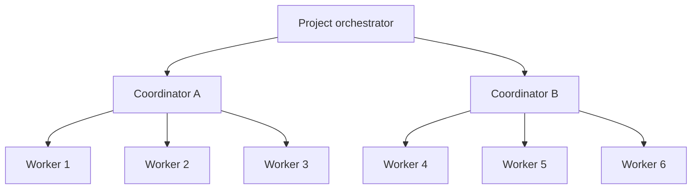

# Coordinator hierarchy for six workers

## Goal

Let one project orchestrator delegate bounded areas of work to two helper
coordinators. Each helper coordinates up to three worker agents and returns
concise status and results to the project orchestrator. The project
orchestrator remains responsible for priorities, cross-area decisions, final
review, and integration.

## Current constraints

- `SpawnOrchestrator` is idempotent per project: a second spawn returns the
  existing active orchestrator. A distinct coordinator role or scope is needed
  before two helpers can be represented as orchestrators in one project.
- `report.Coordinator.DeliverExternal` selects the active project orchestrator.
  Remote report delivery currently does not route each worker's report to its
  parent coordinator.
- Remote worker links record the session that spawned the worker, but reports
  are aggregated at project level. Changing ownership must preserve retries,
  acknowledgements, and duplicate-delivery protection.
- The six-worker plan in
  `docs/backlog/railway/orchestrator-prompt.md` assigns up to two workers per
  machine across three machines. This initiative changes coordination
  hierarchy, not the number of workers or host capacity.
- Railway metrics for the hub showed a 23.84 GB maximum against a 24 GB limit
  over the observed 24-hour window. These are service-level metrics and do not
  identify which process caused the peak. Capture per-process resource data
  during the six-worker workload before attributing the peak to coordinators.

## Proposed behavior

- Keep exactly one project orchestrator as the root coordinator.
- Represent helpers as explicitly scoped coordinator sessions owned by that
  root; do not create two competing root orchestrators.
- Assign each worker to exactly one coordinator and route its report to that
  coordinator. The root receives coordinator summaries and escalations.
- Cap the initial topology at two coordinators and three active workers per
  coordinator. These are configurable safety limits with a total of six workers.
- Keep final integration ownership with the root. Helpers may prepare changes
  and review worker output, but cannot merge into the shared integration branch.
- Preserve a direct root-to-worker path for tasks that do not benefit from a
  helper.

## Delivery phases

1. Measure the current six-worker workload and agree on coordinator/session
   ownership semantics in an ADR.
2. Add durable coordinator ownership and backward-compatible report routing.
3. Add bounded spawning and a pilot with two helpers and three workers each.
4. Validate recovery, duplicate delivery, operator visibility, and resource
   behavior; document rollout and rollback.

## Success criteria

- A root orchestrator can run two coordinator sessions, with at most three
  active workers assigned to each.
- Each worker report reaches its assigned coordinator exactly once, including
  after retries or daemon restarts; the root receives the coordinator's
  summary and escalations.
- The root remains the only session allowed to perform final integration.
- A coordinator failure leaves its work visible and recoverable by the root.
- The six-worker pilot records per-process memory and CPU and demonstrates
  whether coordination changes reduce root load without exceeding the hub's
  configured resource budget.

## Non-goals

- Replicating the Railway hub service or sharing its SQLite volume.
- Increasing the worker count above six.
- Allowing multiple root orchestrators for one project.
- Automatic merging by helper coordinators.
