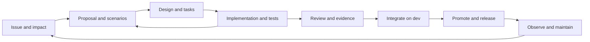

# OpenSpec adoption blueprint

Status: proposed backlog, not an enabled policy. Tracker: [#617](https://github.com/petarnenov/ultra-factory/issues/617).
Audit baseline: `060dd3cdb` on `origin/dev`, 2026-10-23.

## Outcome and scope

Adopt specification driven development across AO's SDLC using repository-local OpenSpec. Every behavior change should connect a reviewed requirement and scenario to its implementation, test evidence, integration commit and release. This initiative plans the migration; it does not claim that creating Markdown or passing OpenSpec validation proves runtime correctness.

Cover the Go daemon and CLI, Electron desktop and web renderer, mobile, public cloud control plane, shared packages, Railway deployments, agent workflows, documentation, security, distribution, support and retirement. The optional `private/ao-cloud` submodule is a separate ownership boundary: its internals were not inspected and its implementation requires an authorized owner. Public contracts and consumers are included here.

## Existing system and adoption gaps

This is a static architecture and SDLC audit: repository inventory, contract sources, workflow definitions, package scripts, operational guidance and representative implementation boundaries were inspected. No runtime behavior, deployed environment, branch protection or full test suite was certified by this audit. Existing documentation can lag code; initial specifications must be checked against implementation and tests, with disagreements recorded rather than silently codified.

| Surface | Existing source and evidence | Required SDD integration |
| --- | --- | --- |
| Intake and planning | `docs/backlog/README.md`, `docs/issue-policy.md`, `.github/ISSUE_TEMPLATE/`, tracker #501 | One issue per implementation PR, exactly one type and priority; change ID, impact, scenarios and dependencies before work starts. |
| Architecture | `docs/architecture.md`, `docs/backend-code-structure.md`, `backend/internal/domain/`, `backend/internal/ports/`, `docs/adr/` | Capability specs describe behavior; ADRs retain decision rationale and invariants. Trace service and adapter boundaries without rebuilding the architecture. |
| Daemon API and CLI | `backend/internal/httpd/controllers/dto.go`, `backend/internal/httpd/apispec/specgen/build.go`, `backend/internal/cli/`, `docs/agents/api-contract.md` | Scenarios cover error envelopes, request IDs, exit codes and wire compatibility; retain code-first OpenAPI generation and manually mirrored CLI DTO tests. |
| Persistence and events | `backend/internal/storage/sqlite/{migrations,queries,gen}/`, `backend/internal/cdc/`, `backend/internal/lifecycle/`, `backend/internal/observe/` | Specify migration/upgrade, restart and CDC behavior; derived status remains unstored, failed probes are not death, dirty worktrees are preserved. |
| Agent execution | `backend/internal/session_manager/prompt.go`, `backend/internal/skillassets/`, `docs/coordinators/operating-contract.md`, `backend/internal/daemon/tracker_intake_wiring.go` | Assign change IDs and bounded tasks; agents read relevant specs and report evidence for the actual head. Intake must not imply issue write-back support. |
| Desktop and web | `frontend/src/{main,renderer,shared}/`, `frontend/e2e/`, `frontend/playwright.config.ts`, `DESIGN.md` | Scenario coverage for IPC, permissions, accessibility, error/loading states and web capability differences; real desktop evidence where mocks cannot prove behavior. |
| Mobile | `packages/mobile/{app,lib}/`, package scripts, `.github/workflows/mobile.yml` | Mobile already has typecheck and unit CI. Add device acceptance mapping for pairing, compatibility, reconnect, push and Chat/TUI; do not confuse unit coverage with device validation. |
| Public cloud | `cloud/internal/{httpapi,auth,billing,worker,workertransport,workerexec,reconcile,postgres}/`, `contracts/cloud/openapi.yaml`, `docs/cloud-development.md` | Tenant/auth, billing, reconciliation, worker lifecycle and PostgreSQL migration scenarios; distinguish the cloud OpenAPI source from daemon code-first generation. |
| Shared packages and Railway | `packages/{cloud-client,product-ui,hub-bff}/`, `deploy/railway/`, `docs/railway/threat-model.md` | Consumer compatibility, cookies/CSRF, REST/SSE/mux proxying, bearer handling, backup/restore and drain acceptance. |
| Security and privacy | `docs/agents/network-boundaries.md`, `.github/workflows/gitleaks.yml`, `docs/telemetry.md`, `backend/internal/remotehost/` | Negative auth and isolation scenarios, secret redaction, telemetry boundaries; preserve loopback unauthenticated primary listener and sole remote identity exemption. |
| CI and review | `.github/workflows/{go,frontend,mobile,issue-policy,comment-policy,e2e-gate-tests,cli-e2e,railway-e2e}.yml`, `scripts/ci-check.mjs` | Add deterministic spec/trace checks, retain full applicable suites and generated drift checks. Draft skipped/neutral jobs are not successful verification. |
| Distribution | `.github/workflows/{build-artifacts,version-bump,daemon-channel,release-latest-guard,version-floor-guard,hub-image,worker-image}.yml`, `docs/agents/distribution.md` | Link requirements to release artifacts, platform smoke, rollback and compatibility; dev integration is distinct from main publication. |
| Operations and maintenance | `deploy/railway/README.md`, `cloud/docs/deployment.md`, `docs/runbooks/`, `backend/internal/sessionhealth/`, `backend/internal/knowledgegraph/` | Incident regressions become scenarios, operational evidence has environment/time/commit, obsolete behavior gets explicit removal deltas. |
| Documentation and knowledge | `docs/documentation-map.md`, `frontend/src/docs/content/`, `docs/superpowers/`, `docs/backlog/knowledge-graph/` | Preserve useful historical designs with links, publish user-facing behavior in the manual, and keep learned hints subordinate to approved specs and current code evidence. |

No `openspec/` setup or OpenSpec package dependency was found at the baseline. Existing designs, ADRs and generated contracts provide valuable inputs but no common requirement-to-release traceability contract. The backlog addresses this gap incrementally.

## OpenSpec fit and reproducibility

Use the upstream `spec-driven` schema and repository-local `openspec/specs/<capability>/spec.md` plus `openspec/changes/<change-id>/` containing proposal, delta specs, design and tasks. Keep archived changes under `openspec/changes/archive/`. Start without beta cross-repository stores or a custom schema; neither is needed to adopt SDD in this repository.

The upstream documentation inspected on 2026-10-23 describes `openspec init`, `new change`, `status`, `instructions`, `validate` and `archive`. Upstream is moving: SDD-01 must select an exact published version, record its source tag, lock its dependency, verify Node compatibility against CI, and test the supported flags. Do not build CI around an unpinned global `@latest` installation. Slash commands are assistant integrations, not portable shell commands; document CLI equivalents and the selected tool profile.

Sources: [OpenSpec repository](https://github.com/Fission-AI/OpenSpec), [concepts](https://github.com/Fission-AI/OpenSpec/blob/main/docs/concepts.md), [CLI](https://github.com/Fission-AI/OpenSpec/blob/main/docs/cli.md), [workflows](https://github.com/Fission-AI/OpenSpec/blob/main/docs/workflows.md). The lifecycle and gates below are proposed AO policy, not claims that upstream enforces them.

## Authority and artifacts

| Artifact | Authority |
| --- | --- |
| GitHub issue and tracker | Scope, priority, dependencies, owner and current delivery status. |
| OpenSpec capability spec on dev | Accepted integration behavior; not proof of production deployment. |
| OpenSpec change proposal and delta | Intended behavior under review; implementation discoveries can revise it with review. |
| ADR and AGENTS guidance | Architectural decisions and working constraints; spec conflicts must be reconciled explicitly. |
| Code-first daemon DTOs and registry | Daemon wire shape; regenerate YAML and frontend schema, never hand-edit outputs. |
| Cloud OpenAPI and SQLite sources | Preserve their documented generation and migration authority; specs reference them. |
| Test and release evidence | Proof for a named scenario, exact revision and environment, with failures/skips retained. |
| Manual, runbooks and historical plans | Usage and operational guidance; archived plans do not override accepted current contracts. |

Proposed AO trace fields: issue, change ID, capability, stable requirement ID, scenario ID, test path and test name, applicable platforms, manual procedure if needed, result, commit and evidence link. These are AO conventions to implement and validate, not built-in OpenSpec fields. Put the initial mapping in a small reviewed `verification.md` per change; SDD-09 decides and tests the minimal machine-readable representation. Avoid a second task database. Keep volatile run results in PR/CI records and link them from the change.

## Workflow and responsibilities

1. Intake owner records user problem, scope, observable acceptance, type/priority and dependencies. Classify behavior change, behavior-preserving maintenance, documentation-only, or emergency fix; classification has a rationale, not a magic bypass label.
2. Author explores current specs, code, tests and ADRs. Draft proposal and delta scenarios before behavioral implementation. Include non-goals, risks, compatibility, security, operations and rollback where relevant. A reviewer confirms testable intent; revise artifacts when implementation changes the design.
3. Author creates tasks with one accountable role and non-overlapping file responsibility. Each PR still closes one implementation issue; an umbrella change may link several child issues and PRs without closing the tracker early.
4. Implementer builds tests tied to scenario IDs, then implementation. Code-preserving tasks may cite existing requirements and explain why no delta is needed. A docs typo does not need a fictional behavior spec. An emergency fix records the regression scenario in the same PR where feasible; any deferred artifact has a named owner and dated follow-up tracked to closure.
5. Reviewer checks semantics, boundary preservation and evidence on the current head. OpenSpec validation checks structure only. Run the existing complete applicable CI jobs; a focused test or a green skipped draft aggregate cannot substitute for them. Honor the per-changed-Go-package 75% bar and explicitly report frontend coverage as unmeasured under current policy.
6. Integrator rebases conflicting changes against current dev, reviews combined deltas and updates accepted specs in the implementation PR. Prepare synchronization/archive as reviewable changes only after verification; incomplete multi-PR changes stay active. Acceptance on dev is not a release claim. Explicitly close issues after confirmed dev merge if default-branch auto-closure does not fire.
7. Release operator links promoted change IDs to main commit, version and artifact digest; executes existing platform and compatibility smoke procedures. Preserve the sole publisher and separate daemon prerelease channel. Never publish to test the process.
8. Operator records actual environment, results and rollback rehearsal. Incidents, regressions, support feedback and deprecations feed new changes. Removal scenarios include migration, retention and documentation implications.

## Capability migration and verification

Seed specs by coherent behavior, not one file per package. First: session lifecycle and workspaces; daemon API and CLI; persistence and events. Then desktop/web and mobile; cloud and shared contracts; security and operations. Each seed requirement needs code and test evidence, or an explicit gap issue. Existing bugs stay labeled as gaps rather than becoming desirable requirements.

Use added/modified/removed/renamed deltas only after testing their semantics with the pinned CLI. For simultaneous changes to the same capability, serialize acceptance or reconcile the combined delta after rebase and rerun validation. Never let archive completion alone close implementation issues.

Verification layers remain distinct: requirement/scenario validation; unit/service and contract tests; integration and generated artifact drift; end-to-end and native-device acceptance; operational and release evidence. Cover success, rejection, retries, restart, concurrency, offline/unknown state and recovery as applicable. Performance criteria must specify workload, environment, metric and an agreed threshold before implementation; do not invent SLO numbers from a single run.

## Rollout gates and completion

Wave 1 establishes toolchain, policy and backend baseline (SDD-01 to SDD-03). Wave 2 adds surface baselines and agent workflow (SDD-04 to SDD-08). Wave 3 supplies trace validation, CI, release and operations (SDD-09 to SDD-12). SDD-13 pilots one ordinary feature, one bugfix and one operational change across these paths. SDD-14 expands enforcement after the pilot report.

Start CI in reporting mode, record omissions explicitly, then make checks required only after passing pilot evidence and a maintainer verifies branch settings. Negative fixtures must demonstrate missing scenarios, broken references, stale test mappings, unsupported exclusions and deletion/rename handling. Do not infer required branch protection from workflow YAML.

Adoption exit criteria: every surface above has an owned capability map; all pilot scenarios have reviewed evidence; schema/tool versions are reproducible; actual required checks reject invalid changes; contributor instructions and release/incident runbooks use the lifecycle; no unresolved high-priority migration blocker. Track the fraction of changed requirements with evidence, scenario gaps, escaped regressions, review rework and cycle time over the pilot and first ten subsequent changes. Set a 100% mapping target for in-scope changed behavior, with explicit manual evidence allowed; this is traceability, not a claim of 100% code coverage.

Rollback of the process means reverting the new gate to reporting mode with an issue explaining why, retaining specs/history and existing CI. Tool upgrades are reviewed dependency changes with validation fixtures. No automatic production rollback, mass historical-plan rewrite, runtime OpenSpec dependency or UI redesign is part of this initiative.
