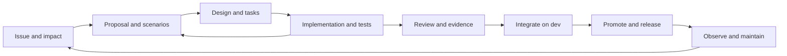

# OpenSpec adoption blueprint

Status: proposed backlog, not an enabled policy. Owner decision interview in progress; see [owner decisions](decisions.md). Implementation must wait for the completed decision record. Tracker: [#617](https://github.com/petarnenov/ultra-factory/issues/617).
Audit baseline: `060dd3cdb` on `origin/dev`, 2026-10-23.

## Outcome and scope

Adopt specification driven development across AO's SDLC using repository-local OpenSpec. Every change, including documentation and formatting, must have a full proposal and geo.architect review under D05. Every behavior change should connect a reviewed requirement and scenario to its implementation, test evidence, integration commit and release. This initiative plans the migration; it does not claim that creating Markdown or passing OpenSpec validation proves runtime correctness.

Cover the Go daemon and CLI, Electron desktop and web renderer, mobile, shared packages used by those surfaces, Railway/self-hosted hub/BFF and remote workers, agent workflows, documentation, security, distribution, support and retirement. AO Cloud is excluded by owner decision D00: no public cloud control-plane, private submodule, tenant/billing/PostgreSQL baseline, cloud-only client/contracts or AO Cloud deployment work. Shared code remains in scope only for supported consumers. This planning exclusion does not delete code or remove existing CI. D01 explicitly retains Railway/self-hosted.

Owner decision D04 includes all supported platforms: macOS, Windows, Linux, iOS, Android and Railway web. Native behavior requires actual-platform evidence; no platform is deferred out of scope. Missing access remains a visible verification gap, never a pass.

## Existing system and adoption gaps

This is a static architecture and SDLC audit: repository inventory, contract sources, workflow definitions, package scripts, operational guidance and representative implementation boundaries were inspected. No runtime behavior, deployed environment, branch protection or full test suite was certified by this audit. Existing documentation can lag code; initial specifications must be checked against implementation and tests, with disagreements recorded rather than silently codified.

| Surface | Existing source and evidence | Required SDD integration |
| --- | --- | --- |
| Intake and planning | `docs/backlog/README.md`, `docs/issue-policy.md`, `.github/ISSUE_TEMPLATE/`, tracker #501 | One issue per implementation PR, exactly one type and priority; change ID, impact, scenarios and dependencies before work starts. |
| Architecture | `docs/architecture.md`, `docs/backend-code-structure.md`, `backend/internal/domain/`, `backend/internal/ports/`, `docs/adr/` | Capability specs describe behavior; ADRs retain decision rationale and invariants. Trace service and adapter boundaries without rebuilding the architecture. |
| Daemon API and CLI | `backend/internal/httpd/controllers/dto.go`, `backend/internal/httpd/apispec/specgen/build.go`, `backend/internal/cli/`, `docs/agents/api-contract.md` | Scenarios cover error envelopes, request IDs, exit codes and wire compatibility; retain code-first OpenAPI generation and manually mirrored CLI DTO tests. |
| Persistence and events | `backend/internal/storage/sqlite/{migrations,queries,gen}/`, `backend/internal/cdc/`, `backend/internal/lifecycle/`, `backend/internal/observe/` | Specify migration/upgrade, restart and CDC behavior; derived status remains unstored, failed probes are not death, dirty worktrees are preserved. |
| Agent execution | `backend/internal/session_manager/prompt.go`, `backend/internal/skillassets/`, `docs/coordinators/operating-contract.md`, `backend/internal/daemon/tracker_intake_wiring.go` | Use repository-local assignment guidance; agents read relevant specs and report evidence for the actual head. Global AO prompts and embedded skills remain outside this adoption task; intake does not imply issue write-back support. |
| Desktop and web | `frontend/src/{main,renderer,shared}/`, `frontend/e2e/`, `frontend/playwright.config.ts`, `DESIGN.md` | Scenario coverage for IPC, permissions, accessibility, error/loading states and web capability differences; real desktop evidence where mocks cannot prove behavior. |
| Mobile | `packages/mobile/{app,lib}/`, package scripts, `.github/workflows/mobile.yml` | Mobile already has typecheck and unit CI. Add device acceptance mapping for pairing, compatibility, reconnect, push and Chat/TUI; do not confuse unit coverage with device validation. |
| Shared packages and Railway | `packages/{product-ui,hub-bff}/`, `deploy/railway/`, `docs/railway/threat-model.md` | Consumer compatibility, cookies/CSRF, REST/SSE/mux proxying, bearer handling, backup/restore and drain acceptance. |
| Security and privacy | `docs/agents/network-boundaries.md`, `.github/workflows/gitleaks.yml`, `docs/telemetry.md`, `backend/internal/remotehost/` | Negative auth and isolation scenarios, secret redaction, telemetry boundaries; preserve loopback unauthenticated primary listener and sole remote identity exemption. |
| CI and review | `.github/workflows/{go,frontend,mobile,issue-policy,comment-policy,e2e-gate-tests,cli-e2e,railway-e2e}.yml`, `scripts/ci-check.mjs` | Add deterministic spec/trace checks, retain full applicable suites and generated drift checks. Draft skipped/neutral jobs are not successful verification. |
| Distribution | `.github/workflows/{build-artifacts,version-bump,daemon-channel,release-latest-guard,version-floor-guard,hub-image,worker-image}.yml`, `docs/agents/distribution.md` | Link requirements to release artifacts, platform smoke, rollback and compatibility; dev integration is distinct from main publication. |
| Operations and maintenance | `deploy/railway/README.md`, `docs/runbooks/`, `backend/internal/sessionhealth/`, `backend/internal/knowledgegraph/` | Incident regressions become scenarios, operational evidence has environment/time/commit, obsolete behavior gets explicit removal deltas. |
| Documentation and knowledge | `docs/documentation-map.md`, `frontend/src/docs/content/`, `docs/superpowers/`, `docs/backlog/knowledge-graph/` | Preserve useful historical designs with links, publish user-facing behavior in the manual, and keep learned hints subordinate to approved specs and current code evidence. |

No `openspec/` setup or OpenSpec package dependency was found at the baseline. Existing designs, ADRs and generated contracts provide valuable inputs but no common requirement-to-release traceability contract. The backlog addresses this gap incrementally.

## OpenSpec fit and reproducibility

Use the upstream `spec-driven` schema and repository-local `openspec/specs/<capability>/spec.md` plus `openspec/changes/<change-id>/` containing proposal, delta specs, design and tasks. Keep archived changes under `openspec/changes/archive/`. Start without beta cross-repository stores or a custom schema; neither is needed to adopt SDD in this repository.

The upstream documentation inspected on 2026-10-23 describes `openspec init`, `new change`, `status`, `instructions`, `validate` and `archive`. Upstream is moving: SDD-01 must select an exact published version, record its source tag, lock its dependency, verify Node compatibility against CI, and test the supported flags. Do not build CI around an unpinned global `@latest` installation. Slash commands are assistant integrations, not portable shell commands; document CLI equivalents and the selected tool profile.

Sources: [OpenSpec repository](https://github.com/Fission-AI/OpenSpec), [concepts](https://github.com/Fission-AI/OpenSpec/blob/main/docs/concepts.md), [CLI](https://github.com/Fission-AI/OpenSpec/blob/main/docs/cli.md), [workflows](https://github.com/Fission-AI/OpenSpec/blob/main/docs/workflows.md). The lifecycle and gates below are proposed AO policy, not claims that upstream enforces them.

## Authority and artifacts

| Artifact | Authority |
| --- | --- |
| GitHub issue and tracker | Scope, priority, dependencies, owner and current delivery status. |
| OpenSpec capability spec on dev | Accepted integration behavior; not proof of production deployment. |
| OpenSpec change proposal and delta | Intended behavior under review; implementation discoveries can revise it with review. |
| ADR and AGENTS guidance | Architectural decisions and working constraints; spec conflicts must be reconciled explicitly. |
| Code-first daemon DTOs and registry | Daemon wire shape; regenerate YAML and frontend schema, never hand-edit outputs. |
| SQLite sources and supported shared contracts | Preserve documented generation and migration authority; specs reference them. AO Cloud contracts are excluded. |
| Test and release evidence | Proof for a named scenario, exact revision and environment, with failures/skips retained. |
| Manual, runbooks and historical plans | Usage and operational guidance; archived plans do not override accepted current contracts. |

Proposed AO trace fields: issue, change ID, capability, stable requirement ID, scenario ID, test path and test name, applicable platforms, manual procedure if needed, result, commit and evidence link. These are AO conventions to implement and validate, not built-in OpenSpec fields. Put the initial mapping in a small reviewed `verification.md` per change. Every PR references its full proposal/change ID and declares affected capabilities, with a reasoned no-runtime-behavior classification where appropriate; SDD-09 defines and tests the machine-readable representation after the early pilot. The checker verifies declared requirements and references, while a reviewer checks the diff for omitted behavior. An empty or absent declaration is not an exemption. Avoid a second task database. Keep volatile run results in PR/CI records and link them from the change.

## Workflow and responsibilities

1. Intake owner records user problem, scope, observable acceptance, type/priority and dependencies. Classify behavior change, behavior-preserving maintenance, documentation-only, or emergency fix; classification has a rationale, not a magic bypass label.
2. Author explores current specs, code, tests and ADRs. Draft the full proposal, acceptance scenarios, design, tasks and verification plan before any implementation, including docs-only or maintenance work. Describe runtime deltas only when applicable; no-behavior classification does not waive proposal approval. Include non-goals, risks, compatibility, security, operations and rollback where relevant. The geo.architect council reviews the proposal under D02. For unresolved decisions or unavailable consuls, D03 gives final authority to the first available arbiter: Claude Fable 5.1, then Codex Astra, then OpenCode DeepSeek Flash 4.1. Obtain and archive an explicit ruling on the exact proposal/revision; do not infer approval from missing votes or elapsed time. The ruling stays within approved scope and hard requirements. If no arbiter is available, block the affected task. Invalidate affected approvals when the design or constraints change.
3. Author creates tasks with one accountable role and non-overlapping file responsibility. Each independently mergeable implementation issue/PR owns one OpenSpec change. An umbrella GitHub tracker links the child issues and changes but owns no shared delta. If a change cannot be completed in one PR, split it into independently valid changes with explicit dependencies before implementation; do not partially apply one change across PRs.
4. Implementer verifies scenario criteria and implements the approved change. Under D05, documentation, formatting, tooling and emergency work all require the full proposal process before execution; there is no deferred-proposal bypass. Code-preserving changes cite existing requirements and explain why runtime deltas are inapplicable while still providing change acceptance and verification. Documentation correctness checks do not require fictional runtime behavior or redundant executable tests.
5. Reviewer checks semantics, boundary preservation and evidence on the current head. OpenSpec validation checks structure only. Run the existing complete applicable CI jobs; a focused test or a green skipped draft aggregate cannot substitute for them. Honor the per-changed-Go-package 75% bar and explicitly report frontend coverage as unmeasured under current policy.
6. Integrator rebases the change against current dev and prepares its accepted spec update and archive in the same implementation PR. Apply its delta once; a repeated check must not mutate specs. The AO archive checker rejects incomplete tasks, missing verification references and unmet prerequisite implementation PRs, including direct filesystem moves. The containing PR need not already be merged: its final head must pass CI and semantic review before integration. Keep current-head results in external CI/review records to avoid a self-referential commit SHA; record the actual dev merge afterward. Acceptance on dev is not a release claim. Explicitly close the child issue after verified dev merge if default-branch auto-closure does not fire.
7. Release operator links promoted change IDs to main commit, version and artifact digest; executes existing platform and compatibility smoke procedures. Preserve the sole publisher and separate daemon prerelease channel. Never publish to test the process.
8. Operator records actual environment, results and rollback rehearsal. Incidents, regressions, support feedback and deprecations feed new changes. Removal scenarios include migration, retention and documentation implications.

## Capability migration and verification

First run SDD-15 on one small capability using a minimal seed, repository-local instructions, geo.architect proposal approval and reviewer-led evidence checks after setup and initial policy. Refine the conventions before expanding the baseline. Seed specs by coherent behavior, not one file per package. Then cover session lifecycle and workspaces; daemon API and CLI; persistence and events. Then desktop/web and mobile; Railway/self-hosted and supported shared contracts; security and operations. Each seed requirement needs code and test evidence, or an explicit gap issue. Existing bugs stay labeled as gaps rather than becoming desirable requirements. D06 delegates code/test/documentation contradictions to geo.architect with D03 final arbitration; record evidence and intended behavior in the proposal rather than automatically choosing code or prose.

Use added/modified/removed/renamed deltas only after testing their semantics with the pinned CLI. For simultaneous changes to the same capability, serialize acceptance or reconcile the combined delta after rebase and rerun validation. Never let archive completion alone close implementation issues. SDD-16 implements AO archival enforcement rather than relying on upstream confirmation prompts or task warnings; the selected CLI version must be tested for override behavior. There is no shared umbrella delta to reapply when child work completes.

Verification layers remain distinct: requirement/scenario validation; unit/service and contract tests; integration and generated artifact drift; end-to-end and native-device acceptance; operational and release evidence. Cover success, rejection, retries, restart, concurrency, offline/unknown state and recovery as applicable. Performance criteria must specify workload, environment, metric and an agreed threshold before implementation; do not invent SLO numbers from a single run.

## Rollout gates and completion

Setup and learning: SDD-01 → SDD-02 → SDD-15 ([#633](https://github.com/petarnenov/ultra-factory/issues/633)). This early pilot seeds only one capability and does not wait for the full baseline, new CI or product integration. Under D07, agents select and execute the pilot cases through the full proposal process, and geo.architect makes the evidence-based final go/no-go decision using D03 arbitration. Its accepted report and convention corrections unblock SDD-03. The pilot issue owns the evaluation; its selected real implementation gets a separate issue/change/PR.

Expansion: SDD-03 → SDD-04 to SDD-09. SDD-08 changes only this repository's instructions and assignment templates. Any future product-level OpenSpec support requires a separate proposal with explicit per-project opt-in, default-off behavior and non-OpenSpec regression coverage.

Verification and operations: SDD-09 → SDD-16 ([#634](https://github.com/petarnenov/ultra-factory/issues/634)) → SDD-10, with SDD-07 also required for CI integration. SDD-16 owns archive completeness and synchronization checks; SDD-10 wires them into CI. SDD-11 and SDD-12 define release and operational evidence. SDD-13 then runs the broad feature/bugfix/operations pilot; SDD-14 enables required checks and measures adoption.

Start CI in reporting mode, then make checks required only after the broad pilot and a maintainer verifies branch settings. Every PR must have an impact declaration, including code-only, promotion, automation and documentation PRs; no-behavior declarations still need the full proposal, rationale and geo.architect approval. No path or change-type exemption is permitted. Path filters must not bypass declaration checks. Negative fixtures cover absent declarations, broken references, rename/deletion, incomplete archives, stale evidence, prerequisite PRs and direct archive moves. External evidence that cannot be read is unavailable, not passed. A required check must not wait for its own success or for its own PR to merge.

Adoption exit criteria: every surface has an owned capability map; both pilots have reviewed evidence; tool versions are reproducible; actual required checks reject invalid declarations/mappings/archives; contributor and release/incident guidance use the lifecycle; no unresolved high-priority migration blocker. Measure PR declaration completeness, declared-requirement mapping completeness, semantic-review gaps, escaped regressions, review rework and cycle time over the pilots and first ten subsequent changes. Require all PRs classified and 100% of declared changed requirements mapped, with explicit manual evidence allowed. Reviewers must check declarations against the diff on the final head. Structural CI cannot prove semantic completeness or discover all undeclared behavior, and these metrics are not code coverage.

Rollback of the process means reverting the new gate to reporting mode with an issue explaining why, retaining specs/history and existing CI. Tool upgrades are reviewed dependency changes with validation fixtures. No automatic production rollback, mass historical-plan rewrite, runtime OpenSpec dependency or UI redesign is part of this initiative.
