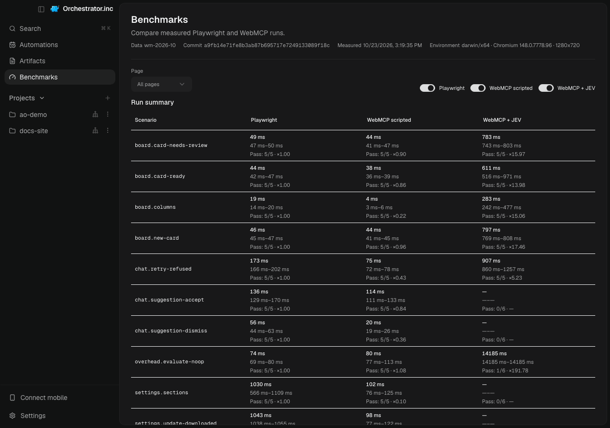
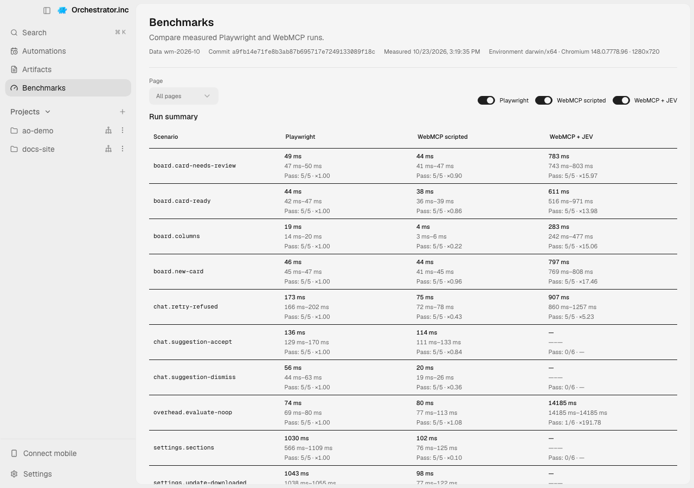

# WebMCP UI testing benchmark

**Status:** Report and screenshot deliverables complete; independent reproduction has not been performed.

Scope: three pages, ten catalog scenarios plus an overhead series, three drivers, and one machine. Pre-measurement analysis and sources: [benchmark report](../../backlog/webmcp/webmcp-report.md). Dashboard: `/#/benchmarks`.

## What was compared

| Driver | Mechanism | Decision step |
| --- | --- | --- |
| playwright | Original spec steps (locators) | None |
| webmcp-scripted | Catalog tool calls via `__aoWebMcp.callTool` | None |
| webmcp-jev | JEV selects each catalog tool (`jev-<model>`), with arguments from the catalog | One API call per step |

## Measurement method

All drivers run in the same Playwright test process, with the same scenario setup, readiness rules, assertions, and timed window. Timing starts after setup, navigation, and readiness, and ends after the last assertion. Browser launch, dev server startup, setup, navigation, readiness waits, and bridge pushes are excluded. Assertion time is measured explicitly and included in total time. The WebMCP drivers call tools through `page.evaluate`; its cost is not removed from scenario results.

Each driver/scenario has one warm-up and five measured repeats, run serially with one worker and no test retries. The summarizer drops warm-ups. Overhead is measured in a separate scenario that performs 50 no-op calls in one timed window. It is a reference and is not subtracted from the other scenarios. Failed attempts count toward pass rate but not latency statistics. JEV decision, browser execution, and assertion medians are separate component summaries; component medians need not add up to total-time medians.

## Results

Machine and environment from the records: Intel(R) Core(TM) i7-10700K CPU @ 3.80GHz, 16 logical CPUs, 40 GiB RAM; macOS x64; Node v24.21.0; Chromium 148.0.7778.96; 1280 × 720 viewport. The records identify platform and architecture but do not include a macOS version. There are 203 records across the three drivers, including warm-ups and failed measured attempts. Values below are the summarizer's medians and measured-repeat ranges; see [raw measurements](measurements.json) and the dashboard's [summary data](../../../frontend/src/renderer/benchmarks/data/summary.json).

| Scenario | Driver | Median (min–max) | Pass rate |
| --- | --- | ---: | ---: |
| board.card-needs-review | playwright | 49.1 ms (46.6 ms–50.2 ms) | 100% (5) |
| board.card-needs-review | webmcp-scripted | 44.1 ms (41.2 ms–46.7 ms) | 100% (5) |
| board.card-needs-review | webmcp-jev | 783.4 ms (742.7 ms–802.7 ms) | 100% (5) |
| board.card-ready | playwright | 43.7 ms (42.3 ms–46.5 ms) | 100% (5) |
| board.card-ready | webmcp-scripted | 37.6 ms (35.7 ms–39.3 ms) | 100% (5) |
| board.card-ready | webmcp-jev | 611.4 ms (515.8 ms–971.0 ms) | 100% (5) |
| board.columns | playwright | 18.8 ms (13.5 ms–19.6 ms) | 100% (5) |
| board.columns | webmcp-scripted | 4.2 ms (2.6 ms–6.1 ms) | 100% (5) |
| board.columns | webmcp-jev | 282.7 ms (242.1 ms–477.0 ms) | 100% (5) |
| board.new-card | playwright | 45.7 ms (45.2 ms–47.4 ms) | 100% (5) |
| board.new-card | webmcp-scripted | 43.8 ms (41.3 ms–44.8 ms) | 100% (5) |
| board.new-card | webmcp-jev | 797.4 ms (769.1 ms–807.9 ms) | 100% (5) |
| chat.retry-refused | playwright | 173.4 ms (165.8 ms–202.5 ms) | 100% (5) |
| chat.retry-refused | webmcp-scripted | 74.8 ms (72.4 ms–77.8 ms) | 100% (5) |
| chat.retry-refused | webmcp-jev | 906.6 ms (859.8 ms–1256.8 ms) | 100% (5) |
| chat.suggestion-accept | playwright | 136.0 ms (129.2 ms–169.7 ms) | 100% (5) |
| chat.suggestion-accept | webmcp-scripted | 113.9 ms (110.9 ms–133.1 ms) | 100% (5) |
| chat.suggestion-accept | webmcp-jev | — | 0% (6) |
| chat.suggestion-dismiss | playwright | 56.0 ms (44.3 ms–62.9 ms) | 100% (5) |
| chat.suggestion-dismiss | webmcp-scripted | 20.0 ms (19.5 ms–25.7 ms) | 100% (5) |
| chat.suggestion-dismiss | webmcp-jev | — | 0% (6) |
| overhead.evaluate-noop | playwright | 74.0 ms (68.9 ms–79.6 ms) | 100% (5) |
| overhead.evaluate-noop | webmcp-scripted | 79.7 ms (76.7 ms–113.3 ms) | 100% (5) |
| overhead.evaluate-noop | webmcp-jev | 14184.6 ms (14184.6 ms–14184.6 ms) | 17% (6) |
| settings.sections | playwright | 1029.5 ms (565.9 ms–1109.2 ms) | 100% (5) |
| settings.sections | webmcp-scripted | 102.0 ms (76.1 ms–125.3 ms) | 100% (5) |
| settings.sections | webmcp-jev | — | 0% (6) |
| settings.update-downloaded | playwright | 1043.4 ms (1038.1 ms–1055.0 ms) | 100% (5) |
| settings.update-downloaded | webmcp-scripted | 98.3 ms (76.9 ms–122.0 ms) | 100% (5) |
| settings.update-downloaded | webmcp-jev | — | 0% (6) |
| settings.update-live-flow | playwright | 1192.2 ms (1135.5 ms–1241.9 ms) | 100% (5) |
| settings.update-live-flow | webmcp-scripted | 145.5 ms (134.4 ms–257.8 ms) | 100% (5) |
| settings.update-live-flow | webmcp-jev | 1768.5 ms (1588.1 ms–1916.7 ms) | 100% (5) |

For `overhead.evaluate-noop`, the median is 74.0 ms for Playwright and 79.7 ms for scripted WebMCP over 50 calls (about 1.5 and 1.6 ms per call, respectively); this is not a universal estimate of `page.evaluate` cost. The JEV overhead row has one passing attempt out of six, so its 14,184.6 ms median is based on only that passing attempt and is not a stable per-call estimate.

Across JEV scenario rows with at least one passing attempt, decision-time medians range from 279.9 ms to 13,964.8 ms and execution medians from 0.0 ms to 40.1 ms. The high decision figure is the overhead scenario, where one of six attempts passed. Those component medians do not sum to total medians. JEV has no latency result where all measured attempts failed: six attempts each for `chat.suggestion-accept`, `chat.suggestion-dismiss`, `settings.sections`, and `settings.update-downloaded`. Their 0% pass rates remain visible in the table.

## Reproduce

From a clean checkout, install the repository's pinned dependencies and use a free local port. The first command runs the Playwright baseline and scripted WebMCP driver; the second is the separate, opt-in JEV run and requires a key configured in the environment. Do not put a key literal in shell history, logs, or files.

```bash
AO_WEBMCP_BENCH=1 AO_PERF_DIR=/tmp/wm AO_PERF_LABEL=dev AO_E2E_PORT=5292 CI=true npm --prefix frontend run test:e2e -- e2e/webmcp-bench.spec.ts --workers=1 --retries=0 --grep-invert webmcp-jev
```

```bash
AO_WEBMCP_BENCH=1 TYPESAFE_API_KEY="$TYPESAFE_API_KEY" AO_PERF_DIR=/tmp/wm AO_E2E_PORT=5292 CI=true npm --prefix frontend run test:e2e -- e2e/webmcp-bench.spec.ts --workers=1 --grep webmcp-jev
```

The protocol also accepts `JEV_MAF_LAB` when `TYPESAFE_API_KEY` is unset. Keep the two run outputs together in `/tmp/wm`, then summarize them:

```bash
node frontend/scripts/benchmarks-summarize.mjs /tmp/wm --out /tmp/wm-summary
```

The runs use the protocol's default six repeats (one warm-up and five measured). For exact comparison, keep the same machine conditions and environment, run without overlapping jobs, and record deviations rather than discarding them. See the full [benchmark protocol](PROTOCOL.md).

## Verification

| Check | Result |
| --- | --- |
| Summarizer reproducibility, record validation, coverage, duplicate identities, committed copies | Passed: 203 records validated by `node frontend/scripts/benchmarks-summarize.mjs frontend/src/renderer/benchmarks/data/measurements.json --check` |
| Results table source | Generated directly from the committed records with `frontend/scripts/benchmarks-summarize.mjs`; values pasted verbatim |
| Secret handling | The report and reproduction commands contain no key value; the JEV key is read from the environment |
| Independent reproduction | Not yet performed; a second developer should report the observed results and environment, recording deviations without requiring a new run to fit these ranges |

## Screenshots

The dashboard screenshots show the committed benchmark summary in the dark and light themes at 1280 × 900.

| Dark theme | Light theme |
| --- | --- |
|  |  |

## Deliberate limits

The app uses a renderer-side WebMCP-shaped shim. This measures the current shim and its test call surface, not native browser WebMCP. The WebMCP drivers also pay `page.evaluate` and Playwright transport overhead; the separate 50-call series gives context but is not subtracted from scenario timings.

JEV selects among catalog actions and cannot generate free-form text. Scenarios that need input use fixed catalog arguments, so these results do not measure an agent composing arbitrary user content. JEV is an early-access service; published rate and pricing limits are unavailable. Network decision time can vary, and failures are retained in pass rates.

This is one machine and one benchmark session with five measured repeats per scenario and driver. The min–max ranges describe those samples only; they are not confidence intervals, universal performance guarantees, or CI thresholds. Some scenarios are layout-only or observation-oriented and do not represent a complete user workflow. Board state changes are supplied by a test bridge, which is excluded from timing.

## Answer: what performance to expect

In this measured batch, scripted WebMCP medians are 4.2–145.5 ms across scenarios with 100% pass rates, while Playwright medians are 18.8–1,192.2 ms with 100% pass rates. Excluding the overhead series, passing JEV catalog scenarios have total-time medians of 282.7–1,768.5 ms, or 1.5–17.5 times the corresponding Playwright medians; four JEV catalog scenarios had no passing measured attempt. These are scenario-specific results from this one machine and should not be generalized beyond the measured setup.
